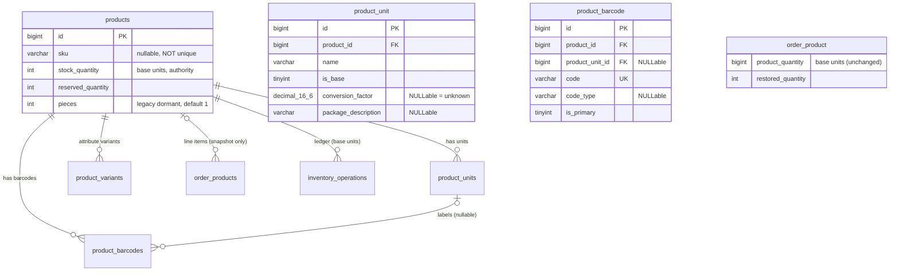

# Product Packaging, Units & Barcodes — Architecture Discovery & Design Audit

| | |
|---|---|
| **Date** | 2026-10-31 |
| **Type** | Architecture Discovery & Design (READ-ONLY phase — no code changed) |
| **Scope** | Product units, packaging, multi-barcode management, unit conversion, inventory & pricing integration |
| **Verified by** | Static source inspection, runtime MySQL schema inspection (information_schema / SHOW INDEX / row counts), `php artisan route:list`, one executed existing test run on an isolated database |
| **Status** | DESIGN PROPOSAL — awaiting explicit approval before any implementation |

---

## 1. Executive Summary

The codebase currently has **no product-unit, packaging, or product-barcode domain whatsoever** (VERIFIED at runtime: no such columns on `products`/`product_variants`/`order_products`, no such tables). Barcodes exist only in the **WMS layer** (`locations.barcode`, `packages.barcode`, `BarcodeResolver`, `BarcodeScanService`) and today an EAN-13 scan resolves *only if the barcode equals a product/variant SKU string* (TESTED: `BarcodeScanTest` 11 passed, incl. "smart detection identifies ean13 product without type").

Stock is a **single-authority, single-base-unit** system: `products.stock_quantity` / `product_variants.stock_quantity` guarded by `OrderReservationService` (reserve → commit → release → restored) and `StockOperationService` (WMS receipt/transfer), with placement rows (`product_locations`) explicitly non-authoritative (docs/audits/inventory-target-design.md, Decision 1–3).

**Recommendation (Option C)**: two small product-scoped tables —

- `product_units` — per-product selling/packaging units with a nullable `conversion_factor` expressed in **base units** (the unit `products.stock_quantity` already counts in). Base unit factor = 1. NULL factor = "carton size unknown" (operable for lookup, rejected for quantity math rather than defaulted to 1 or 0).
- `product_barcodes` — many barcodes per product, optional link to a product unit, **globally unique `code`**, plain string type, format metadata optional.

All conversion happens **at the service boundary** (`UnitConversionService` + a resolver extension); **no quantity column anywhere changes its unit semantics**, `OrderReservationService`/`StockOperationService`/`ProductPricingService` are untouched in v1. Carton/shipping-side flows (purchasing/receiving) map onto the existing `receipt` operation of `InventoryOperation`.

`products.pieces` (int, default 1, dormant — all rows = 1, no business logic reads it) is deliberately **not reused**: it cannot represent multiple named units, has no barcode linkage, and changing its semantics would silently alter exports/imports.

Historical integrity is preserved because order lines continue to store **base-unit quantities + price snapshots**; any future "sell in cartons" support adds *snapshot* columns (`ordered_unit_*`) and must **never** rewrite quantity semantics of `order_products.product_quantity`. Deletion of units referenced by history is made **RESTRICT-safe via snapshot-by-value** (no FK from orders to units).

---

## 2. Skills Discovered and Used

Environment skill inventory was enumerated before starting. Loaded and applied:

| Skill | Used for |
|---|---|
| `architecture` | Boundary/authority evaluation, alternatives comparison, trade-off and revisit-trigger discipline |
| `ecommerce` | Catalog/variant/inventory/pricing invariants (price integrity, stock authority, order state) |
| `laravel-best-practices` | "Consistency first" rule — every recommendation below mirrors an existing repo convention; conventions override the skill's generic defaults; potential conflicts resolved explicitly (§4.6) |
| `product-engineering` | Translating the Excel scenario into explicit business rules, actors, edge cases, acceptance criteria |

Other skills in the environment were inspected for relevance but deliberately **not** loaded (not applicable to a read-only architecture task): `clean-code-guard`, `test-guard`, `woo-guard`, `wp-guard` (no WP/Woo code), `devops`, `deploying-to-cloud`, `docs-guard`, `security-engineering`, `testing`, `testing-best-practices`, `self-improvement`, `find-skills`, `lean-ctx`, `opencode`, `report`. Lean-CTX tooling was used for repo context retrieval throughout.

**No skill conflicted with the project.** One generic-vs-project tension is documented in §4.6.

---

## 3. Repository Discovery Findings

### 3.1 Product Domain (VERIFIED)

| Item | Evidence |
|---|---|
| Canonical `Product` model | `packages/marvel/src/Database/Models/Product.php` (L26–670). Table `products`; fillable incl. `sku`, `stock_quantity`, `reserved_quantity`, `sold_quantity`, `pieces`, `price`, tax fields; `SoftDeletes`; auto-SKU `PRD-xxx` on creating (L130–137); `FastShippingScope` global scope (L140–143) |
| Product repository | `packages/marvel/src/Database/Repositories/ProductRepository.php`: `storeProduct` L105–158 (DB::beginTransaction…commit, pricing snapshot via `ProductPricingService::calculateProductPricingFromData` L123, `addVariants`, `syncProductPlacements` L146), `updateProduct` L161 |
| Product create/update request | `packages/marvel/src/Http/Requests/ProductCreateRequest.php` L61–122 (`pieces` L75 `sometimes|int|min:1`; WMS `locations.*` placements L103–106; `variants.*` rules L109–121). Permission middleware is on **routes** (see 3.9) |
| Variants | `packages/marvel/src/Database/Models/ProductVariant.php` (table `product_variants`; own SKU auto `VAR-…` L23–27; own `stock_quantity`/`reserved_quantity`; variant price made nullable by migration `2026_10_15_000003_make_product_variants_price_nullable.php`). Legacy `Variation.php` (table `variation_options`) exists but is **dead at runtime** — no live table (see 3.8) |
| Import / Export | `packages/marvel/src/Services/Import/ProductImportService.php` (L29–1090): upsert-by-SKU per row (`processProductRow` L391–456: per-row transaction, rollback, `failedRows[]`); **missing cells handled by `isset()`-scoped building in `buildProductData`** (L860–970) — a missing cell simply omits the attribute; invalid values throw per-row. Multi-sheet workbook read by `packages/marvel/src/Jobs/ImportProductsJob.php` via `PhpOffice\PhpSpreadsheet\IOFactory` (L421, L470; sheets `products`, images L424; `countRows` L458–495; cancellation via signal files; `rollbackCreatedData` L367) |
| Export | `packages/marvel/src/Exports/Sheets/ProductsSheetExport.php` L79/L112 includes `pieces`. Import contract: `tests/Feature/ImportExport/ExcelContractTest.php` L152 asserts **`pieces` is an optional importer field, NOT part of the export contract** |

### 3.2 Runtime Database Schema (VERIFIED — live MySQL)

Executed via a read-only probe script (phpinfo-level `$` issues in PowerShell prevented inline `tinker --execute`; script used `information_schema` + `SHOW INDEX` + counts):

```
products|sku|varchar(191)|null=YES|def=NULL        (index products_sku_index, UNIQUE=0 → NOT unique)
products|pieces|int|null=NO|def='1'
products|stock_quantity|int|null=NO|def='0'
products|reserved_quantity|int|null=NO|def='0'
product_variants|sku|varchar(191)|null=YES|def=NULL  (product_variants_sku_unique UNIQUE=1)
order_products|product_quantity|int|null=NO
order_products|restored_quantity|int|null=NO|def='0'
PRODUCTS COUNT: 11   VARIANTS COUNT: 3   (dev-scale dataset)
PIECES NONNULL: 11  PIECES DISTINCT: [1]     ← dormant
meem_products: ABSENT at runtime (model packages/marvel/src/Database/Models/MeemProduct.php is dead code; see docs/catalog-backfill-runbook.md)
UNIT/BC/PACK TABLES: ["package_items","packages","packing_stations","packing_tasks"]   ← all WMS packing, none product-level
product_locations cols: product_id, product_variant_id, location_id, warehouse_id, quantity, allocated_hint
```

Baselines: `packages/marvel/database/migrations/2020_06_02_051901_create_marvel_tables.php` — products L106–150 (`pieces` int default 1 L122; **no barcode/unit columns**), `product_variants` L152–175 (sku unique, stock per variant; `product_id` FK `onDelete('cascade')` L164).

**Conclusion**: no `barcode|bar_code|ean|upc|unit|measure|conversion_factor|carton|packaging` column/table exists anywhere in the product domain (VERIFIED by repo-wide sweeps; all carton/packaging/conversion hits are WMS packing, currency conversion, or media-library conversion — i.e. false friends).

### 3.3 Inventory Domain (VERIFIED)

| Authority | Evidence |
|---|---|
| Order reservation lifecycle | `app/Services/Inventory/OrderReservationService.php` L12–28 header: *"Single authoritative owner of the ORDER inventory reservation lifecycle"*; `reserveForOrder` L48–83 (locked two-pass claim), `commit` L89–115 (stock decrement, sold_quantity++), state machine none→active→committed/released/restored; `available = stock_quantity − reserved_quantity` |
| Restore / returns | `app/Services/Inventory/InventoryRestoreService.php`: committed→restored; partial restores via `order_products.restored_quantity` remainder (L57–135) |
| WMS intake/relocate | `app/Services/Inventory/StockOperationService.php` L20–36 hard invariants: *"Authority is SKU-level; products.stock_quantity for SIMPLE, product_variants.stock_quantity per-VARIANT for VARIABLE…"*, *"Receiving ADDS to the authority; transfer NEVER changes the authority"*, placements are non-authoritative hints, reservations owned exclusively by `OrderReservationService` |
| Ledger | `app/Models/Inventory/InventoryOperation.php`: operations `receipt|transfer|initial_placement`, **`quantity` decimal(2)**, `idempotency_key`, variant-aware (migration `2026_10_13_000001_create_inventory_operations_table.php`) |
| Documented decisions | `docs/audits/inventory-target-design.md` Decisions 1–5: SKU-level authority rows ADOPTED; new inventory-item identity table REJECTED ("duplicates authority"); polymorphic identity REJECTED ("prevents meaningful DB constraints"); ledger-summed authority REJECTED (would fork a second ledger); reconciliation report-only |
| Quantity meaning | **All quantities are "base units"** (what the SKU counts in — piece-level). No unit semantics anywhere in order/stock math |

### 3.4 Sales / Purchasing (VERIFIED)

- Order line model: `packages/marvel/src/Database/Models/OrderProduct.php` — `product_quantity` (int, base units), snapshots only (`product_name`, `product_sku`, prices, currencies, tax). **No unit columns.**
- **No purchase-order module exists**: repo-wide `purchase` sweep produced only PayPal `purchase_units` payloads, refund-policy seeders, and prose. No PO tables/models/controllers/routes. → "Purchasing" in this design is served by the **existing** receiving path (`InventoryOperation` receipt + `StockOperationService`), not by inventing a PO subsystem.
- **POS**: no POS controllers/routes found in `route:list` output (full products/barcode listing below) — treated as not present.
- Pricing authority: `packages/marvel/src/Services/Pricing/ProductPricingService.php` L14–110 — *"All monetary arithmetic uses integer cents"*; computes base/discount/flash-sale composition for product **and variant**; products carry `price`, `price_after_discount`, `price_after_flash_sale`. Runtime pricing docs referenced in AGENTS.md are stale (§4.6).

### 3.5 Existing Barcode Implementation (VERIFIED, all WMS-bound)

| Component | Evidence |
|---|---|
| Location barcodes | `locations.barcode` (DB-unique; see tests/Unit/WmsLocationAuditStaticTest.php L60–66), seeded `LOC-…` |
| Package barcodes | `packages.barcode` + `package_number` (`App\Models\Fulfillment\Package`) |
| Universal resolver | `app/Services/Warehouse/BarcodeResolver.php` L27–110: order = location → **product by `sku` (or numeric PK fallback L89–91)** → variant by `sku` → fulfillment_number → package → order_number; throws `UnknownBarcodeException` |
| Heuristic scanner | `app/Services/Warehouse/BarcodeScanService.php` L60–63: pure digits of length **8/12/13/14 (EAN-8/UPC-A/EAN-13/GTIN-14) ⇒ 'product'**; then `scanProduct()` resolves via SKU match |
| Endpoint | `api/v1/admin/barcode/scan` (POST/GET), permission `Permission::BARCODE_SCAN` (`packages/marvel/src/Rest/Routes.php` L587–590) |
| **Gap** | A real EAN-13 like `6287029972752` resolves **only if it *is* the SKU string**. Multiple barcodes per product are impossible (SKU is scalar; products.sku not even unique). No barcode→unit concept |

### 3.6 Architectural Conventions (VERIFIED)

- **Layering**: Marvel package = legacy kernel (models/repos/requests/exports/imports/jobs); `app/Services/**` = modern domain services (Fulfillment, Inventory, Checkout, Currency, Warehouse); `app/Models/**` = newer models. Controllers thin; services orchestrate; per-op `DB::beginTransaction/commit/rollback` inside service methods (ProductRepository L108–148, ProductImportService L394–453).
- **Validation**: FormRequests (`Marvel\Http\Requests\*`), `authorize()` true, permission middleware on routes: `permission:view-products|create-product|…` pattern (`packages/marvel/src/Rest/Routes.php` L120–198).
- **Permissions/translation**: `Marvel\Enums\Permission` + `resources/lang/{en,ar}/permissions.php` (barcode.scan L510/514) — new permission keys must land in **both** language files.
- **Enums over magic strings** (AGENTS.md Phase 10; e.g. `ItemType`, `ProductType`).
- **Response shape**: controllers return repository results (models/collections with appended attributes, e.g. `Product::$appends` L118–123); new endpoints for B2B-style endpoints in `app/` return resources (see WMS controllers).
- **Migrations**: dated `2026_MM_DD_NNNNNN_*.php` in `database/migrations`, additivealter-pattern with defensive `Schema::hasColumn` checks (e.g. `2026_09_09_000001_simplify_tax_to_direct_rates.php` L125–126 try/catch drops).
- **Tests**: `tests/{Unit,Feature,Concurrency,performance}` + `tests/Concerns` (e.g. `CreatesTestTables`). Unit tests include **static-audit style** tests asserting source conventions (WmsLocationAuditStaticTest). PHPUnit 10, guarded: the suite **refuses** to run against the shared DB and prescribes a process-local isolated DB (TESTED — see §11 Test Evidence).

### 3.7 Routes Verified (TESTED via `php artisan route:list`)

Products: `api/v1/products` CRUD (`Marvel\Http\Controllers\ProductController`), bulk-delete, export/import family (`admin.products.import/status/cancel/download-errors/sample`), `api/v1/admin/products/{product}/placements` (WMS), dashboard analytics. Barcode: `api/v1/admin/barcode/scan` POST/GET only.

### 3.8 Runtime Table Absences (VERIFIED)

`meem_products` absent (dead model). `variation_options` absent at runtime (Feature/CheckoutRegressionTest.php L48 builds it *only* inside tests when missing).

---

## 4. Business Requirements (from the supplied scenario)

Actors: catalog admin, data-entry via Excel, store staff (WMS), (future) purchasing.

**Excel scenario** (Бahrini spices example): Product SKU `145401`; Piece barcode `6287029972752`; Piece packaging `150 grams`; Carton barcode `6287029972769`; Carton quantity `24`. Packaging types are free-form; same product may have Piece/Carton/Box/Pack with arbitrary quantities.

### 4.1 Rules (explicit)

| # | Rule | Confidence |
|---|---|---|
| B1 | A **barcode is a lookup key**: identifies (product, unit). Multiple barcodes per product AND per unit allowed (e.g. manufacturer + store EANs). | INFERRED (standard retail; scenario shows one barcode per unit but nothing forbids more) |
| B2 | Barcode **global uniqueness** required for unambiguous scan resolution — same code must never mean two different saleable things. | INFERRED + RISK if violated (scan returns wrong parcel of truth) |
| B3 | NULL = unknown/not provided; 0 = explicit known zero (rejected where semantically invalid, e.g. conversion factor); **missing row = configuration doesn't exist** (no fake values). | USER REQUIREMENT |
| B4 | A product may have: no barcodes (A); piece barcode only (B); carton barcode only (C); unknown carton quantity (D); a single selling unit only (E); unit without barcode (F); incomplete Excel row (G). | USER REQUIREMENT |
| B5 | Unknown carton quantity must NOT default to 1 or 0; the unit may exist, barcodes may exist, but quantity-bearing operations are refused until a real factor is supplied. | USER REQUIREMENT |
| B6 | Inventory keeps **one base-unit store**; no second authority. | USER REQUIREMENT + existing architecture invariant |
| B7 | Carton price may differ from `N × piece price` (wholesale). Pricing composition must remain in one place. | INFERRED (business example table) |
| B8 | Historical orders must never change when packaging config changes. | USER REQUIREMENT |

### 4.2 Conversion-factor representation (analysis)

The domain evidence shows both integer cartons (24) and **descriptive fractional packaging** (the scenario's "150 grams" is a weight descriptor of the piece). Existing numeric precedent: `inventory_operations.quantity` is already `decimal(…,2)` (VERIFIED) — a decimal-capable quantity column exists in the ledger, while order/stock authorities are int. Decision: `conversion_factor DECIMAL(16,6)` — accepts 24, 6.5 (e.g. half-weight trade units), 0.4 kg-in-kg style future needs; costs nothing; int would silently truncate. Store **pieces-per-unit** (unit → base) so math is `base = amount_in_unit × factor` only — never division at write time.

### 4.3 Barcode model (analysis)

- Belong to the **product** (not directly to stock authority rows), with an **optional unit link** — barcode exists even when its unit row is absent/misconfigured (Scenario C).
- Multiple per product + multiple per unit: YES (B1).
- Globally unique: YES (B2) — a single `UNIQUE(code)` covers both cross-product and cross-unit duplication with one constraint.
- Formats: keep `code` raw VARCHAR (leading zeros matter for EAN — never store numeric); optional informational `code_type` column; format detection already exists (`BarcodeScanService::detectProbableType`) and is reused — no new validator maze (SRM/YAGNI).

### 4.4 Variants (analysis)

Existing variants = attribute combinations (color/size) each with own SKU + own stock row. Packaging units describe a **physical property of the master product** (carton of 24), not an attribute combination.

- Product-level units (chosen): import-friendly; barcode uniqueness trivial; inventory unchanged (conversion × factor at service edge; variant stock rows unaffected); selling unaffected; zero migration of existing rows.
- Variant-level packaging would require: N× unit rows, variant-aware import sheets, variant-scoped barcode uniqueness, and conversion routing through `resolveAuthority` docs — all today **without demonstrated need** (no such Excel sheet was described).
- A polymorphic `unitable` is rejected — `inventory-target-design.md` Decision 1 already rejected polymorphic identity for exactly this reason (weak DB constraints).
- Deferred option: a nullable `product_variant_id` on `product_barcodes` (NOT polymorphic — ordinary FK) documented as roadmap item if variant-specific EANs are actually supplied. Not built in v1 (YAGNI, revisit trigger in §8).

### 4.5 Inventory authority (analysis — "no second authority")

Continue storing stock **only** in base units. Conversion is a presentation/edge concern:

```
amount_base = amount_in_unit × conversion_factor(s.unit)   (UnitConversionService, single place)
```

Authorities (`OrderReservationService`, `StockOperationService`, `InventoryRestoreService`) keep receiving base-unit quantities exactly as today. Nothing in their code changes; the ledger (`InventoryOperation`) gains optional reference context only if later needed.

### 4.6 Skills vs project conventions — conflicts resolved

- `laravel-best-practices` "consistency first" agrees with AGENTS.md 21.4: **new domain capability → `app/`**, referencing marvel-owned models. Applied: new models/services/tests in `app/`, NOT inside `packages/marvel`.
- AGENTS.md cites `docs/architecture/runtime-pricing-architecture.md`; **that directory does not exist** (VERIFIED). Pricing evidence was taken from the live service + tests instead (`tests/Unit/ProductPricingServiceTest.php`). Noted as documentation drift, not silently "fixed".
- Generic Laravel skill suggests `Route::model`/resource classes everywhere; project precedent (Marvel product endpoints) returns repository models with appended attributes — the design therefore keeps existing response shapes and adds **new** resources only for the **new** endpoints.

---

## 5. Existing Architecture — Summary Table

| Concern | Current state | Effect on this feature |
|---|---|---|
| Price authority | `ProductPricingService` (cents-safe, discount/flash composition) | Unit pricing must compose **inside** it or use an explicit extension point — never a parallel calculator |
| Stock authority | `OrderReservationService` (+ `StockOperationService` WMS counters; hints non-authoritative) | Units never touch counters; only base-unit quantities cross the boundary |
| Order lines | Base-unit qty + value snapshots; `restored_quantity` remainder logic | Add only nullable *snapshot* columns later; never reinterpret `product_quantity` |
| Import pipeline | Multi-sheet workbook, per-row tx, error download, cancel signals | New data = **new sheets**, same service patterns; products-sheet contract untouched (ExcelContractTest) |
| Scan pipeline | `BarcodeResolver` kind-based chain; permission-guarded endpoint | Product-barcode lookup inserted at the resolver's 'product' branch with graceful fallback to SKU (backward compatible) |
| Currency | Multi-currency snapshots at order time | Unit prices must carry `currency_code` context in SQL-ignorant ways only via composition, no new persistence (open question Q3) |

---

## 6. Architecture Alternatives

### Option A — `products` / `product_units` / `product_barcodes`

1. Structure: units table per product (factor in base units) + barcodes (product + optional unit).
2. Relations: Product 1—N Units; Product 1—N Barcodes; Unit 0—N Barcodes.
3. Advantages: single concept for "carton/box/pack/gram-bag"; import maps 1:1 to the Excel semantics; factor+barcode normalized properly; barcode table gives many-per-product without column explosion.
4. Disadvantages: needs app-level guarantee "exactly ≤1 base unit per product" (DB can't partial-index in MySQL 8).
5. Existing-module impact: none until "sell in units" activated.
6. Extensibility: variant FK columns can be added later; variant-level factor expansion possible.
7. Complexity: medium.
8. Integrity: strong (unique code, FK chain, CHECK-like app rules, factor > 0).

### Option B — `products` / `product_packagings` / `product_barcodes`

1. Structure: same as A but semantically "packaging" only.
2. Advantages: reads naturally for carton-heavy businesses.
3. Disadvantages: **cannot express non-packaging units** (grams/kg tier names, half-piece sales) without abuse; naming misleads later — would force a second table anyway ("units"), a fork of truth. Excel column semantics ("Piece Packaging: 150 grams") conflates descriptor with the unit itself; a packaging-only table would bury the piece unit as a fake row.
4. Existing-module impact: same as A.
5. Extensibility: worse (two vocabularies: unit vs packaging).
6. Complexity: same.
7. Integrity: same, plus conceptual confusion → drift risk.

### Option C (chosen) — Option A refined against this codebase

= Option A's structure with these project-specific corrections:

- Units live in `app/Models/Product/` as **product-scoped** rows (no global UoM registry — global libraries are theoretical popularity, not need; each product's "Carton" has its own 24-vs-12 factor, so per-product rows are required regardless, and a global registry only adds indirection).
- `product_units.name` keeps the free-form merchant label (supports Arabic strings; no enum of packaging types — scenario explicitly says types are examples, not mandates).
- Base-unit row is **optional**: the implicit base is *whatever `products.stock_quantity` counts today*. A base row may exist for naming/describing ("Piece, 150 grams") but is never required, and the `pieces` default-1 legacy column is left untouched.
- `product_barcodes` is product-scoped with optional unit link; scan resolution extends the existing resolver chain (no parallel scan endpoint).
- The conversion service and resolver extension live in `app/Services/…`, mirroring `app/Services/Inventory` conventions.

**Decision record**

- Decision: two product-scoped tables (`product_units`, `product_barcodes`); conversion at service boundary; no second authorities.
- Evidence: §3 runtime schema (absence of any unit column), `inventory-target-design.md` rejections (new identity tables, polymorphism, ledger forks), import pipeline conventions, resolver chain contract.
- Alternatives: A vs B vs polymorphic vs global-UoM vs reusing `pieces` — rejected §5/§4.4/TR-7.
- Trade-offs: gains multi-unit + multi-barcode + null-safe conversion at the cost of one more table pair + one "exactly-one-base" app rule.
- Confidence: High (structure), Medium (variant scoping — revisit trigger below).
- Revisit triggers: (a) variant-level packaging data appears in real imports; (b) measured need for global UoM analytics; (c) PO/procurement module landing.

---

## 7. Recommended Database Design (proposal — no migration executed)

> Types target MySQL 8 (live DB)._unsigned FKs; timestamps standard; no randomized design.

### 7.1 `product_units`

| Column | Type | Null | Default | Purpose |
|---|---|---|---|---|
| id | BIGINT UNSIGNED PK | NO | auto | |
| product_id | BIGINT UNSIGNED | NO | — | FK → `products.id` **ON DELETE CASCADE** (product owns; `products` uses SoftDeletes so cascade is an emergency path only — RISK noted in §12) |
| name | VARCHAR(191) | NO | — | Merchant label (`'Piece'`, `'كرتون'`, `'Carton'`) — free-form, no enum |
| is_base | TINYINT(1) | NO | `0` | Marks the canonical unit (factor=1 semantics); app rule: ≤1 per product |
| conversion_factor | DECIMAL(16,6) | **YES** | NULL | **Pieces per this unit.** NULL = unknown (Scenario D) — lookup works, quantity math refuses. Base units are created with factor=1 (app-enforced). CHECK-equivalent rules app-level: NULL or > 0. No default 1: a NON-base unit with factor 1 is semantically a second base — rejected as data, not defaulted |
| package_description | VARCHAR(191) | YES | NULL | Free-form descriptor exactly as supplied (`'150 grams'`) — never parsed into numbers (Scenario F/`piece packaging`) |
| status | TINYINT(1) | NO | 1 | Active flag for soft-retirement of a unit in UIs |
| created_at / updated_at | TIMESTAMP | NO | now | |

Indexes/constraints:
- `UNIQUE(product_id, name)` — stops accidental "Carton" duplicates per product (import idempotency aid).
- `INDEX(product_id)`.
- **App-enforced invariant (transaction, lock): at most one row `(product_id, is_base=1)` per product.** MySQL has no partial index; the app rule + test covers it (documented RISK I-1).

Nullable rationale: `conversion_factor` NULL = "carton exists, size unknown" (B5 — the row must exist because a barcode references it; math refuses); `package_description` NULL = not provided. **No other nullables needed.**

### 7.2 `product_barcodes`

| Column | Type | Null | Default | Purpose |
|---|---|---|---|---|
| id | BIGINT UNSIGNED PK | NO | auto | |
| product_id | BIGINT UNSIGNED | NO | — | FK → `products.id` CASCADE |
| product_unit_id | BIGINT UNSIGNED | **YES** | NULL | FK → `product_units.id` **ON DELETE RESTRICT** — deleting a unit that has barcodes is refused until barcodes are deleted/reassigned (prevents silently turning "carton barcode" into "unspecified" during refactors). NULL = barcode belongs to the product's base/implicit identity (Scenario C) |
| code | VARCHAR(64) | NO | — | Raw barcode string. VARCHAR not BIGINT — EANs keep leading zeros; supports any symbology. **UNIQUE(code)** global (B2) |
| code_type | VARCHAR(24) | YES | NULL | Informational: `ean13|upc|gtin14|other` — heuristic detection already exists in `BarcodeScanService::detectProbableType` (reused, not duplicated) |
| is_primary | TINYINT(1) | NO | 0 | Label priority only (primary piece barcode), not security-relevant |
| created_at / updated_at | TIMESTAMP | NO | now | |

Indexes/constraints:
- `UNIQUE(code)` — covers "duplicate across products" AND "duplicate across packaging units" cases with one constraint; lookup index is free (leftmost).
- `INDEX(product_id)`, `INDEX(product_unit_id)`.
- App rule: a NEW barcode for a (product, unit) that already has one is allowed (multiple EANs per unit are real).

NULL strategy: `product_unit_id` NULL is a **first-class business state** ("barcode known, unit row not"), not missing data. Rough guide applied deliberately:

| State | Representation |
|---|---|
| Barcode unknown | **Row does not exist** (Scenario A/B) |
| Barcode known, unit unknown | `product_barcodes` row, `product_unit_id` NULL |
| Unit unknown-quantity | `product_units` row, `conversion_factor` NULL |
| 0 factor | Rejected (meaningless) — 0 is only ever a *quantity*, never a factor |

### 7.3 Deletion behavior summary (deliberate)

| Edge | Behavior | Why |
|---|---|---|
| Product deleted | Units CASCADE; Barcodes CASCADE | Mirror `products.id` FK pattern of `product_variants` (L164); `SoftDeletes` means this is only for force-deletes |
| Unit deleted | `product_barcodes.product_unit_id` RESTRICT | Barcode must be explicitly cleared/repointed; protects against accidental "carton barcode becomes piece-anonymous" regressions |
| Barcode deleted | always allowed; lookup falls back to SKU | Barcodes are keys, not history |
| Historical orders | **No FK** from `order_products` to units — snapshot columns (values) only | Order lines stay immutable even when unit config changes (B8) |

### 7.4 ER diagram



*(Node labels shown for the two new tables as both `product_unit`/`product_barcode` singular-entity display; actual table names plural as declared.)*

---

## 8. Laravel Integration Design (no code written)

### 8.1 Component map (file locations per project conventions)

| Component | Suggested location (does NOT exist yet) |
|---|---|
| Models | `app/Models/Product/ProductUnit.php`, `app/Models/Product/ProductBarcode.php` (own tables; `belongsTo` Marvel `Product`) |
| Relations on `Product` | none required in v1 (models own the belongsTo) — avoids touching the fat model |
| Conversion service | `app/Services/Inventory/UnitConversionService.php` — pure conversion: `toBase(productId, ?unitId, amountInUnits): int|float` + inverse; throws typed exception when factor NULL/zero-equivalent |
| Barcode resolution | Extend `app/Services/Warehouse/BarcodeResolver::resolveProduct()` — **first** try `ProductBarcode::where('code')` (dedicated query method `resolveProductBarcode($code)`) enriching result with `unit` context; on null fallback to existing SKU/PK logic exactly as today (backward compatible; TESTED contract preserved — §11) |
| FormRequests | `app/Http/Requests/Product/StoreUnitRequest.php`, `UpdateUnitRequest.php`, `StoreBarcodeRequest.php` — barcode: `required`, `string`, `max:64`, unique `product_barcodes.code` with `ignore($id)`; unit: factor `nullable|numeric|gt:0`, `is_base` boolean |
| Controllers | `app/Http/Controllers/Api/Admin/Product/ProductUnitController.php`, `ProductBarcodeController.php` — thin: validate → service transaction → resource |
| Service | `app/Services/Product/ProductCatalogService.php` (new, small): transactional create/update/delete of units + barcodes, single-base invariant lock, uniqueness conflict → 422 on duplicate-key exception |
| Resources | `app/Http/Resources/Product/ProductUnitResource.php`, `ProductBarcodeResource.php` |
| Permissions | `permission:manage-product-units` (or reuse `create-product/update-product` conservatively) + lang keys in **en + ar** (`resources/lang/{en,ar}/permissions.php`) |
| Import | Extend `Marvel\Services\Import\ProductImportService` with `processUnitSheet`, `processBarcodeSheet` + new sheets in `ImportProductsJob` reader (`product_units`, `product_barcodes`, keyed by `product_sku`), sample workbook updated by ProductImportController::sample — **products sheet untouched** |
| Events (only if required later) | `ProductUnitUpdated` → recompute derived prices — deliberately deferred (no listener exists that would need it) |

No repositories created — `ProductRepository` pattern is Marvel-legacy; the two new models have trivial persistence and services suffice (no invented layer).

### 8.2 Workflow walkthroughs (design-level)

1. **Create product** — existing flow untouched (`ProductRepository::storeProduct`); units/barcodes created afterward via the new endpoints or included later in import.
2. **Add unit (carton, 24)** — POST admin endpoint → `ProductCatalogService` in tx: check `is_base` uniqueness (lock `products.id` row), insert with `conversion_factor=24` or NULL; respond with `ProductUnitResource`.
3. **Add barcode** — POST → validate unique(`code`) app-level + catch integrity violation (MySQL 1062) → re-lookup conflict target → 422 with conflicting product+unit (needed by import/merge UX).
4. **Update packaging info** — same service; changing factor only affects **future** computations; old orders untouched (snapshot-by-value).
5. **Barcode lookup (WMS scan)** — `BarcodeResolver` first consults `product_barcodes`; returns `{kind: 'product_barcode', product, unit|null, barcode}`; if miss > existing chain unchanged. Response of `/admin/barcode/scan` keeps its envelope; new richer payload appears only for resolver hits (compatible — kind key already discriminates).
6. **Import units/barcodes** — new sheets: `product_units`: columns `product_sku, unit_name, conversion_factor, package_description, is_base`; `product_barcodes`: `product_sku, barcode, unit_name, code_type, is_primary`. Missing cells (Scenario G) → cell skipped (`isset` pattern = existing `buildProductData` convention). Unknown product SKU → row error (matches `processVariantRow` L460–475 behavior).
7. **Incomplete Excel rows** — barcode row without SKU → failed row with message; unit row without factor → still imported (NULL = unknown, B5). Whole import never aborts; partial tolerance identical to today.
8. **Purchase 5 cartons** (= receiving — no PO module exists today): quantity = 5 × factor → `StockOperationService` receipt authority ADD in **base units** (e.g. 120); conversion via `UnitConversionService` at the request boundary; factor NULL → 422 with explicit message.
9. **Sell 3 pieces** — as today: checkout → `OrderReservationService` reserve/commit 3 base units. No code change.
10. **Sell 2 cartons** (future capability gate): request `{unit: carton, qty: 2}` → convert 2×24=48 **base** at the cart/checkout validation edge; `order_products.product_quantity`=48 (base) **plus** new nullable snapshot columns `ordered_unit_id/name/factor/quantity` (design-only, migration NOT executed in this phase); reservation/commit see 48 exactly like any other physical line.
11. **Return 1 carton** — restore path: remainder per line uses base quantities; if the line was ordered in cartons, restoring "1 carton" = 24 base increments through the same snapshot mapping (design note only).
12. **Adjust inventory by +5 pieces** — WMS adjust op unchanged (base units).

**What is explicitly NOT changed in v1**: `OrderReservationService`, `StockOperationService`, `InventoryRestoreService`, `ProductPricingService`, checkout, cart, existing routes, existing response envelopes, products sheet contract.

---

## 9. Nullable-Fields Strategy (explicit answer to Requirement 1)

| Question | Answer |
|---|---|
| Which columns nullable? | `product_units.conversion_factor` (unknown size), `product_units.package_description` (unprovided), `product_barcodes.product_unit_id` (product-level barcode), `product_barcodes.code_type` (informational) |
| Which NOT NULL? | `name`, `is_base`, `status`, `code`, `is_primary`, both `product_id` FKs |
| Optional relationships | Unit↔Barcode optional both ways |
| Rows vs NULLs | *Absence* encodes "not configured" (no barcode, no carton); *NULL* encodes "exists but value unknown" (factor); *0* never used for unknown amounts |
| Validation at API edge | Units: factor nullable, `gt:0` when present; barcodes: `required`; creating SECOND base unit → 422 by service rule |
| Excel | Missing barcode column in products sheet / empty sheet cell ⇒ **no row created** (never sentinel strings) |

---

## 10. Pricing Integration (Requirement 6)

Current: one price authority (product + variant `price`, discount, flash sale) — no per-unit existence. For `Piece 10 / Carton 220` (≠ 240):

- **Chosen**: add optional `product_units.unit_price DECIMAL(12,2) NULL` (unnamed until PRD review — included here as the price slot). Rule: NULL ⇒ price = factor-proportional derivation from `ProductPricingService` result at request time; NOT NULL ⇒ composed by `ProductPricingService` as the **base input for that unit's line** (discount/flash/tax/composition logic still owned by the service).
- This keeps the price compiler single-source (discount/flash composition logic is not duplicated; data is).
- Currency handling reuses existing composition paths; per-unit price overrides would inherit catalog currency like product price. (Open question Q3.)

Confidence: Medium (awaiting explicit business confirmation in Q2), documented as decision with revisit trigger.

---

## 11. Test Evidence (actually executed in this session)

| Command | Result |
|---|---|
| `php artisan tinker --execute=…` (schema probe; superseded by probe script after PowerShell `$` mangling) | `ParseErrorException` (documented honestly — superseded by scripted probe below) |
| script `C:\Users\mohta\AppData\Local\Temp\opencode\meem-schema-probe.php` (repo untouched) → `information_schema`,`SHOW INDEX`,counts | **PASS** — full column/index evidence §3.2 |
| `php artisan route:list` (filtered products/barcode) | **PASS** — §3.7 |
| `php artisan test --filter=BarcodeScanTest` | First attempt **REFUSED by suite guard** against shared DB `catch` (safety behavior verified). Re-run with prescribed isolation: `$env:DB_DATABASE='catch_verify'` → **PASS: 11 tests, 26 assertions**, incl. `smart detection identifies ean13 product without type`, `scan product by sku with explicit type`, `scan requires authentication/permission` |

Static code findings are labeled VERIFIED above; runtime-DB findings are labeled VERIFIED (runtime) with the probe script as source; behavior actually executed = TESTED.

---

## 12. Risks & Migration Considerations

| ID | Risk / Consideration | Mitigation (design-level) |
|---|---|---|
| R-1 | `phones/products.sku` is **NOT unique** (products) — barcode uniqueness must never be derived from SKU | Dedicated `product_barcodes.code` UNIQUE index |
| R-2 | Adding FKs to products tables touches a table with global scopes (`FastShippingScope`) and media/searchable hooks — schema change is additive-only (new tables; **zero** alterations to `products`) | New migrations only create new tables/cols |
| R-3 | Exactly-one-base-unit can't be a MySQL index | Service-level transaction + row lock + regression test; documented RISK with revisit trigger |
| R-4 | `products.pieces` dormant col may tempt reuse | Decision TR-7: do not overload semantics; it stays as-is |
| R-5 | `product_units` CASCADE from `products` mass force-deletes | Documented; Product uses soft deletes in practice |
| R-6 | Excel import extension must not regress existing contract (ExcelContractTest L152) | New sheets only; contract test re-run as gate |
| R-7 | Resolver change must keep 11 green tests green (barcode-scan suite + SKU tests) | Insert-before-fallback ordering; contract asserted by existing tests |
| R-8 | Live DB quantities int & devs/dev-scale only (11 products) — import volume modest | Batch import conventions already exist |
| R-9 | AGENTS.md stale doc refs (`docs/architecture/…` missing) | Not silently rewritten in this phase; flagged |

## 13. Implementation Roadmap (proposed M1–M4, each gate-verified)

1. M1 — Models + migrations (2 new tables) + `UnitConversionService` + permission/lang keys + static-audit Unit test (existing `WmsLocationAuditStaticTest` pattern) + model tests. Gate: isolated-DB migrations + unit tests green.
2. M2 — Admin CRUD endpoints (units, barcodes) + FormRequests + resources + resolver integration + `BarcodeScanTest` extension. Gate: feature tests incl. permission tests.
3. M3 — Import/export: sheets `product_units`, `product_barcodes`, sample workbook + ExcelContractTest + partial-row tests.
4. M4 (gated by business answers Q1/Q2) — Carton-selling/checkout integration: price slot + order-line snapshot columns + reservation-through-conversion tests. **Not started without explicit approval** (touched authorities: checkout, reservation).

## 14. Open Questions & Unknowns (business must answer)

1. **Q1** — Should storefront customers buy cartons, or is it B2B/WMS only? (gates M4)
2. **Q2** — Confirm wholesale unit prices (220 vs 240) — discounts/flash sale apply to the carton line? If no per-unit price override should exist, this column falls out.
3. **Q3** — Per-unit price currency behavior under multi-currency (inherit catalog currency as products do today — assumed).
4. **Q4** — Variable products (attribute variants): identical packaging across variants assumed — confirm; triggers variant-scoped barcodes/units if not.
5. **Q5** — Is `150 grams` descriptive-only, or do products need weight-governed profiles (kg pricing)? (Assumed descriptive-only.)
6. **Q6** — Barcode symbology strictness: are mixed formats (alpha codes, internal label barcodes) allowed? (Assumed permissive — VARCHAR + free `code_type`.)
7. **UNKNOWN (evidence gap)** — No runtime production data stats beyond the dev DB (11 products). Volume/perf implications are design-review only, not measured.
8. **UNKNOWN** — Whether merchant-facing UI (admin SPA) consumes the pieces/units admin — out of backend scope this round.

---

### 15. Acceptance criteria checklist (for future implementation review)

- [ ] Scenario A–G all pass with zero fake/derived-forced values, without product rejection.
- [ ] `UNIQUE(code)` DB-enforced; duplicate insert returns targeted 422
- [ ] Barcode with NULL `product_unit_id` resolves product; unit with NULL factor refuses quantity math with explicit 422 (not 500) — not defaulting.
- [ ] Existing `BarcodeScanTest` remains green after resolver extension.
- [ ] ExcelContractTest remains green (products sheet untouched).
- [ ] Single-message "unit conversion" location (UnitConversionService only).
- [ ] Authorities unchanged: `OrderReservationService`/`StockOperationService` diff empty in M1–M3.
- [ ] Right `ar`+`en` permission keys seeded.
