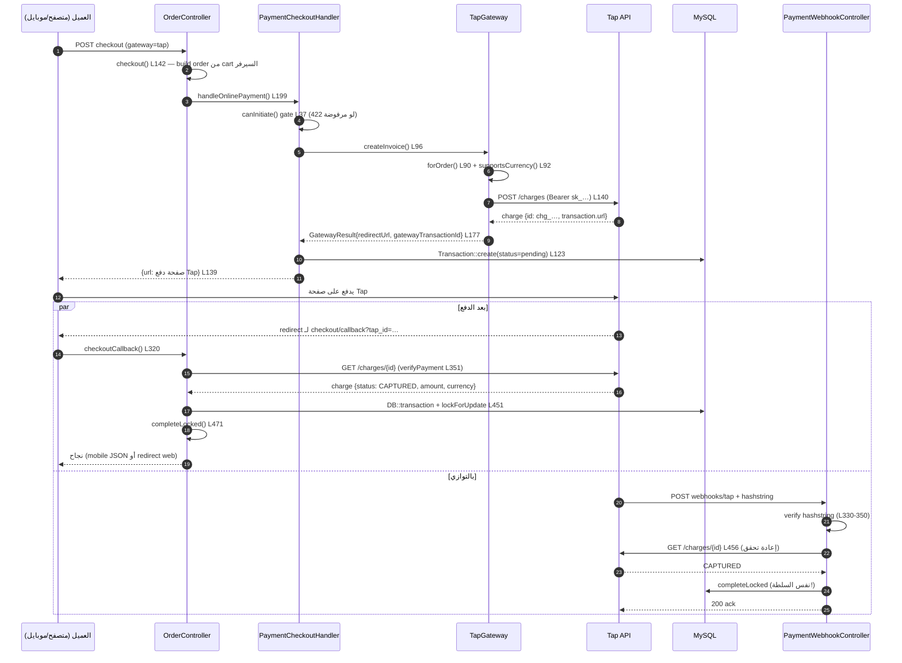
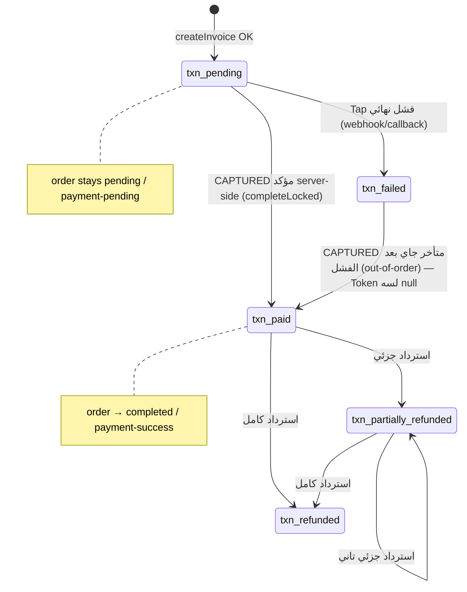

# دليل المطور — شرح تكامل Tap Payments من الأول للآخر

> **اللغة:** الشرح كله بالمصري البسيط، لكن أسماء الكلاسات والدوال ومسارات الملفات وحقول الـ API بتتقال بالإنجليزي زي ما هي — لأن ده اسمها في الكود.
>
> **مصدر الشرح:** الكود الفعلي الموجود في الـ repository ده، مش تصميم مقترح. كل مسار ملف ورقم سطر مذكور حقيقي. الدليل ده مرجع تعليمي — مش تقرير تدقيق (تقرير التدقيق في `docs/audits/tap-payments-integration-audit.md`).
>
> **تاريخ الإعداد:** 2026-10-27 · Laravel 10.30.1 · PHP 8.2.30

---

## 1. الصورة الكبيرة — يعني إيه Payment Gateway أصلاً؟

### يعني إيه بوابة دفع؟

لما العميل يضغط "ادفع" في المتجر، فلوسك مش بتنتقل من جيبه لرصيدك على طول. في وسيط موثوق (بنك أو شركة دفع) بيتأكد إن الكارت صالح، وإن العميل كتب الـ PIN أو الـ OTP صح، وإن المبلغ اتحول فعلاً. الوسيط ده اسمه **Payment Gateway**. انت مش بتكلم البنك بنفسك — انت بتكلم البوابة، والبوابة بتتكلم البنك.

### Tap بيعمل إيه، وLaravel بتاعنا بيعمل إيه؟

- **Tap** (api.tap.company) هو البوابة: بيستقبل طلب "اعمل عملية شحن بالمبلغ X بالعملة Y"، بيرجّع صفحة دفع هوستّها هو (KNET، مدى، فيزا...)، وبيرجّعلك قرار الدفع.
- **تطبيقنا Laravel** هو التاجر: بيبني الطلب (order)، بيحسب المبلغ، بيطلب من Tap إنشاء **charge**، بيستنى رد Tap، وبعد التأكيد بيكمّل الأوردر (فاتورة، مخزون، إيميل).

### الفرق بين Order وPayment Record وTap Charge — ودي أهم فكرة في الدليل

| المفهوم | يعني إيه | بيتخزن فين عندنا | امتى بيتعمل |
|---|---|---|---|
| **Order** | طلب الشراء نفسه: المنتجات، العنوان، المبلغ الكلي، حالته | جدول `orders` (Model: `Marvel\Database\Models\Order`) | أول ما العميل يكمّل checkout |
| **Payment record (Transaction)** | سجل محاولة الدفع للأوردر ده: المبلغ، العملة، مرجع البوابة، الحالة | جدول `transactions` (Model: `Marvel\Database\Models\Transaction`) | أول ما ننجح في إنشاء charge عند Tap |
| **Tap Charge** | كائن العملية عند Tap نفسه — ليه `id` شكله `chg_XXXX` وحالة `status` | **عند Tap مش عندنا** — احنا منخزنّش نسخة كاملة منه، بس مرجعه (`gateway_transaction_id`) وملخص allowlisted في `gateway_response` | لما Tap يوافق على إنشاء الشحن |

### ليه "إنشاء الـ charge" مش نفس "تأكيد الدفع"؟

إنشاء الـ charge معناه Tap فتح صفحة دفع — **مش معناه العميل دفع**. العميل ممكن يوصل لصفحة الدفع ويقفل المتصفح. عشان كده الـ charge بيبدأ بحالة `INITIATED` وبيتحول لـ `CAPTURED` بس لو الدفع اتم بنجاح. احنا منينفعش نعتمد على إن العميل "رجع لموقعنا" عشان نقول الأوردر اتحول — لازم نسأل Tap نفسه.

### ليه الـ backend لازم يكون هو سلطة حالة الدفع؟

لأن كل حاجة من المتصفح ممكن يتلاعب فيها: العميل يقدر يعدّل query parameters، يعيد تشغيل الـ redirect، يبعت payload مزوّر. الوحيد اللي نقدر نثق فيه هو:
1. **نداء server-to-server** من تانيتنا لـ Tap (`GET /charges/{id}` بسر secret key).
2. **Webhook موقّع** من Tap نفسه بنفس الـ secret.

عشان كده عندنا قاعدة صارمة في الكود: **مفيش أي تحويل لأوردر لـ paid إلا بعد إعادة تحقق server-side** — سواء جاي من الـ redirect أو من الـ webhook. هتشوف ده في الكود تحت بالسطر والرقم.

---

## 2. الملفات الحقيقية في الـ repository ووظيفة كل واحد

الترتيب هنا هو ترتيب دورة حياة الدفع، مش ترتيب أبجدي. لكل ملف: ليه موجود، في أنهي طبقة، مين بيناديه، بيندّي على مين، بياخد إيه ويرجّع إيه.

### طبقة التوجيه (Routing)

| الملف | السطور | الوظيفة |
|---|---|---|
| `routes/api.php` | L131-132 | `checkout/callback` و`checkout/error-callback` (GET أو POST) باسمي `api.checkout.callback` / `api.checkout.errorCallback` بـ middleware `throttle:payment-callback` — دي اللي Tap بيرجّع العميل ليها بعد الدفع |
| `routes/api.php` | L136-138 | ثلاثة webhooks موقّعين: `stripe` و`paypal` و**`tap`** باسم `api.checkout.webhooks.tap` بـ middleware `throttle:payment-webhook` — دي اللي **Tap نفسه** بيدق عليها (server-to-server) |

**ليه throttle على الـ webhooks؟** لأن دي الـ endpoint الوحيد اللي أي حد على الإنترنت يقدر يدق عليه. الـ rate limit بيمنع إن حد يغرقنا بمحاولات تحقق. (الـ throttle مش بديل عن التحقق من التوقيع — الاتنين مع بعض.)

### طبقة الـ Controllers (HTTP)

| الملف | الدالة | الوظيفة |
|---|---|---|
| `app/Http/Controllers/Api/General/OrderController.php` | `checkout(OrderCreateRequest $request)` — L142 | نقطة دخول الدفع: بتاخد الـ request الـ متvalidate، بتجيب الـ cart من السيرفر، بتبني الأوردر، وبتحسب المبلغ من `$order->total_price` **مش من العميل** (L189-192) |
| نفس الملف | `checkoutCallback(Request $request)` — L320 | بيستقبل العميل الراجع من Tap، وبيعمل إعادة تحقق server-side، وبكمّل الدفع عبر الـ completion authority |
| نفس الملف | `checkoutErrorCallback(Request $request)` — L620 | نفس الفكرة لكن لما Tap يرجّع العميل على مسار الفشل |
| `app/Http/Controllers/Api/General/PaymentWebhookController.php` | `tap(Request $request)` — L304 | بيستقبل الـ webhook الموقّع من Tap، بيتحقق من الـ hashstring، وبحوّل الـ state Machine للـ state الصحيح |

**ليه الـ controller رفيع؟** لأن الـ controller مسؤولية الـ HTTP بس: يقرا الـ request، ينده على service، يرجّع response. منطق الأعمال (إيه اللي يحصل لما الدفع يناجح) عايش في الـ services.

### طبقة الخدمات (Services) — ملفات `app/Services/Payment/`

| الملف | الدالة/المسؤولية | ليه موجودة |
|---|---|---|
| `PaymentCheckoutHandler.php` | `handleOnlinePayment()` L28-140 | المنسّق (orchestrator) لبدء الدفع: بوابة `canInitiate`، إنشاء الـ charge، تسجيل الـ transaction، رجّع رابط التحويل |
| `PaymentGatewayRegistry.php` | `canInitiate($gateway, $method, $currency)` | بوابة "البوابة دي مسموح بيها دلوقتي؟" — بتقرا الإعدادات (config + admin settings) وترفض بأسباب واضحة (disabled / unsupported currency) |
| `PaymentGatewayFactory.php` | `make($code)` | يبني الـ adapter المناسب للبوابة المطلوبة — بيضمن إن كلبوابة عايشة في كلاس لوحدها |
| `PaymentGatewayRegistry.php` | discovery بالـ config | يقرا `payment.gateways.*` من `config/payment.php` ويسجّل البوابات — عشان كده إضافة Tap محتاجة **صفر bindings** جديدة |
| `PaymentCurrencyResolver.php` | `forOrder(Order $order)` L26-48 | **سلطة العملة**: أوردر snapshot `catalog_currency_code` → `currency_code` → العملة الكتالوجية الحالية → fallback طوارئ أخير `payment.default_currency` من الـ config (L46-48). مفيش أي hardcode |
| `CurrencyPrecision.php` | `decimalsFor()` L28 / `roundForCurrency()` | جدول أس عشري لكل عملة (KWD 3 خانات، USD 2 خانة) — سلطة التقريب |
| `PaymentCompletionService.php` | `completeLocked()` L48+ | **سلطة إتمام الدفع الوحيدة** — كل مسارات النجاح (callback + webhooks) بتعدى منها |
| `PaymentRefundService.php` | `refund()` L76+ | سلطة الاسترداد: الـ ledger، الـ idempotency، حدود المبلغ، وبعدها كلمة الـ adapter |
| `TapWebhookVerifier.php` | `verify()` L41-75 | التحقق من توقيع الـ webhook (hashstring) بطريقة Tap الرسمية |
| `app/DTOs/GatewayResult.php` | DTO | العقد الموحّد بين أي adapter والباقي: `success`, `redirectUrl`, `gatewayTransactionId`, `amount`, `currency`, `status`, `errorMessage`, `rawResponse` |

### طبقة الـ Adapters — ملفات `app/Services/Gateway/`

| الملف | الوظيفة |
|---|---|
| `TapGateway.php` | الحديث مع Tap API: `createInvoice()` L83 (إنشاء charge)، `verifyPayment()` L188 (إعادة تحقق GET)، `refund()` L245، `isConfigured()`، `supportsCurrency()` — **فقط حديث مع البروفايدر**، مفيش منطق أوردر ولا inventory هنا |
| `StripeGateway.php` / `PayPalGateway.php` | نفس الشكل للبوابات التانية — عشان تقدر تقارن وتشوف إن Tap ماشي على نفس النمط |

**ليه الـ adapter منفصل عن الـ service؟** عشان لو Tap غيّر الـ API بتاعه غدا، بنعدل ملف واحد. وبنقدر نكتب unit test للـ adapter بـ `Http::fake()` من غير ما نلمس الداتابيز.

### طبقة الـ Models — `packages/marvel/src/Database/Models/`

| الملف | اللي مهم تعرفه |
|---|---|
| `Order.php` | Constants: `ORDER_STATUS_PENDING = 'pending'` (L18-21 تقريباً)، `ORDER_STATUS_COMPLETED = 'completed'` (L20)، `PAYMENT_STATUS_PENDING = 'payment-pending'` (L34)، `PAYMENT_STATUS_SUCCESS = 'payment-success'` (L35)، `PAYMENT_STATUS_REFUNDED = 'payment-refunded'` (L37). **خد بالك:** الحالة مش `'success'` — دي `'payment-success'` وده سبب بق فشل اختبار مرة قبل كده |
| `Transaction.php` | الـ fillable فيه `gateway_transaction_id`, `idempotency_key` (L22, L27)، والعلاقة `order()` — السجل المحلي لمحاولة الدفع |

### طبقة الـ Config والاختبارات

| الملف | الوظيفة |
|---|---|
| `config/payment.php` L53-72 | بلوك `tap` (التعريف L61-72، الكومنت التوثيقي L53-60): `class`, `enabled` (افتراضي `false`), `secret_key`, `base_url`, `source_id`, `supported_currencies` |
| `.env.example` L327-347 | أسماء المتغيرات البيئية `TAP_*` — القيم الحقيقية عمرها ما تتحدّث في الملف ده |
| `tests/Unit/TapGatewayTest.php` (16 اختبار) / `tests/Unit/TapWebhookVerifierTest.php` (8) | اختبارات بدون داتابيز: سلوك الـ adapter والـ verifier بـ `Http::fake()` |
| `tests/Feature/Payment/TapGatewayFlowTest.php` (11) / `TapWebhookTest.php` (14) | اختبارات داتابيز كاملة: التدفق من الـ route لحد الـ rows |
| `tests/CreatesApplication.php` L20-34 | **الحارس**: بيمنع أي اختبار يشتغل على الداتابيز المشتركة `catch` — لازم عزلتها في `catch_verify` |

---

## 3. التسلسل الفعلي من "العميل داس Pay" لـ "الأوردر اتأكد"

### المخطط الزمني (Mermaid)



### شرح كل خطوة بالترتيب — مزامنة ولا asynchronous؟

| # | الخطوة | الملف والدالة | المزامنة |
|---|---|---|---|
| 1 | العميل يقدّم checkout | `OrderController::checkout` L142 (`routes/api.php`: `checkout/store` route) | متزامن |
| 2 | بناء الأوردر من الـ cart | `OrderService::addItemsInOrder` — المبلغ من الداتابيز مش من العميل | متزامن |
| 3 | بوابة "البوابة مفعّلة والعملة مدعومة؟" | `PaymentGatewayRegistry::canInitiate` — عبر `handleOnlinePayment` L37 | متزامن |
| 4 | إنشاء الـ charge عند Tap | `TapGateway::createInvoice` L83-186 — HTTP call `POST /charges` L140 | متزامن (30 ثانية timeout) |
| 5 | تسجيل الـ transaction المحلي | `PaymentCheckoutHandler` L123-133 — الحالة `pending` والعملة من الـ resolver L130 | متزامن |
| 6 | رجّع رابط صفحة دفع Tap | `handleOnlinePayment` L139 — `{'url': $result->redirectUrl}` | متزامن (نهاية الطلب الأول) |
| 7 | العميل يدفع عند Tap | برا سيطرتنا تماماً | — |
| 8 | **مسار أ**: الـ redirect callback | `OrderController::checkoutCallback` L320 → `verifyPayment` L351 (GET server-to-server) → completion L451-509 | متزامن (طلب HTTP جديد) |
| 9 | **مسار ب**: الـ webhook الموقّع | `PaymentWebhookController::tap` L304 → تحقق hash → `completeFromProviderRef` L395 → `verifyPayment` L456 → completion | متزامن (طلب HTTP جديد) — **يمكن ييجي قبل أو بعد المسار أ** |
| 10 | الإتمام النهائي (اللي بيتكرر في المسارين) | `PaymentCompletionService::completeLocked` L48+ تحت `lockForUpdate` — بيلون الـ token، بيكتب `status='paid'` و`payment_status='payment-success'`، وبيطلق الأحداث | متزامن جوّه transaction واحد |
| 11 | الـ fulfillment والجوانب | جوّه نفس الـ transaction (أو عبر listeners) | حسب التصميم القديم للنظام |

**نقطة مهمة:** المسارين (8 و9) ممكن يوصلوا بأي ترتيب، أو واحد فيهم بس. عشان كده الإتمام **idempotent** — لو الاتنين جاءوا، التاني هيلقى الـ token اتعلمّن ويخرج بدون ما يعمل حاجة تانية.

---

## 4. شرح الكود الفعلي — مقطع مقطع

كل مقطع ده كود حقيقي من الملفات (مقتطفات مختصرة بfaithfulness مع تعليم السطر). هشرح كل قطعة: بتاخد إيه، بترجّع إيه، ليه الشرط موجود، وإيه اللي ينهار لو اتشال.

### 4.1 نقطة الدخول — المبلغ جاي من السيرفر مش من العميل

`app/Http/Controllers/Api/General/OrderController.php` L186-199:

```php
if ($paymentMethod === 'online') {
    // Round to the order currency exponent so 3dp totals (KWD/...) reach
    // the gateway intact instead of being truncated to 2dp here.
    $orderPrice = \App\Services\Payment\CurrencyPrecision::roundForCurrency(
        (float) $order->total_price,                      // ← من الأوردر
        $this->currencyResolver->forOrder($order)          // ← سلطة العملة
    );
    if ($orderPrice <= 0) {
        // D-05: zero-value online orders complete WITHOUT the gateway.
        return $this->completeZeroValueOnlineOrder($request, $order, $gateway);
    }
    return $this->paymentCheckoutHandler->handleOnlinePayment($request, $order, $orderPrice, $gateway);
}
```

**شرح بالمصري:**
- `$order->total_price` ده المحسوب من الـ cart والسيرفر — **العمره ما بيجي من الـ request**. لو خليت العميل يحدد المبلغ، هيعمل أوردر بـ 0.01 ويأخذ طلب بـ 100 جنيه.
- `roundForCurrency()` بترجّع المبلغ على عدد الخانات العشرية بتاع العملة. مثال: أوردر KWD بـ 13.255 — من غير السطر ده كان ممكن يتقطع لـ 13.26 في مرحلة غلط.
- الشرط `<= 0` (D-05): أوردر بـ صفر (استخدام نقاط أو قسيمة كاملة) مكمل من غير بوابة ولا charge — استثناء مقصود وموثق.

**إيه اللي ينهار لو اتشال الـ rounding؟** عمليات 3dp (البحرين، الكويت، عمان) هتبقى فيها خطأ تقريب قبل ما توصل للبوابة، والـ mismatch الحساس في التحقق هيقولك "المبلغ مش مظبوط" ولو مؤسسةك شغالة على استرداد هيقابل رقمين مختلفين.

### 4.2 بوابة البدء — ما ينفعش تبدأ دفع على بوابة مكرّشة

`app/Services/Payment/PaymentCheckoutHandler.php` L36-78 (مقتطف):

```php
$orderCurrencyForGate = $this->currencyResolver->forOrder($order);
$gate = $this->gatewayRegistry->canInitiate($gateway, 'online', $orderCurrencyForGate);

if (!$gate['ok']) {
    if (($gate['reason'] ?? '') === 'currency_unsupported') {
        return $this->apiResponse(
            __('message.ERROR.PAYMENT_CURRENCY_UNSUPPORTED', ['currency' => $orderCurrencyForGate]),
            422, false
        );
    }
    return $this->apiResponse(__('message.ERROR.PAYMENT_GATEWAY_UNAVAILABLE'), 422, false);
}

// ...

// Double supportsCurrency check (deliberate, not redundant):
if (!$gatewayInstance->supportsCurrency($orderCurrency)) { /* 422 كمان */ }
```

**شرح بالمصري:**
- `canInitiate` بتقرا الإعدادات المدموجة (config + إعدادات الأدمن) — لو `tap.enabled = false` بترجع `ok=false` وهنا بقولة 422. **هذا بيفسر إن Tap مكرّش افتراضياً: فتحه مأثرش على PayPal ولا Stripe.**
- الـ **double check** مش رداءة — الأول بيقرا الإعدادات المدموجة (registry)، والتاني بيقرا الإعدادات اللي الـ adapter نفسه بيقراها. لو حصل drift (صف إعدادات قديم، الـ adapter بيقرا config مختلف)، الفحص التاني بيصده هنا قبل ما نكلم Tap.

**إيه اللي ينهار لو اتشال؟** عميل يقدر يبدأ charge على بوابة مكرّشة — والدهن فلوس معلقة عند البروفايدر مفيش completion يستقبلها.

### 4.3 إنشاء الـ charge — بناء الـ payload

`app/Services/Gateway/TapGateway.php` L83-138 (مقتطف):

```php
public function createInvoice(Order $order, float $amount, string $callbackUrl, string $errorUrl, array $metadata = []): GatewayResult
{
    $orderCurrency = $this->currencyResolver->forOrder($order);      // L90 — العملة مش hardcoded

    if (!$this->supportsCurrency($orderCurrency)) {                  // L92 — رفض مبكر
        return new GatewayResult(
            success: false,
            errorMessage: __('message.ERROR.PAYMENT_CURRENCY_UNSUPPORTED', ['currency' => $orderCurrency]),
        );
    }

    if ($amount <= 0) { /* رفض */ }                                  // L99

    $chargeAmount = CurrencyPrecision::roundForCurrency($amount, $orderCurrency);  // L108

    $payload = [
        'amount'   => $chargeAmount,                                 // رقم، مش string
        'currency' => $orderCurrency,                                // ISO 4217 من الأوردر
        'customer' => [
            'first_name' => $this->customerFirstName($order),        // L114
            'email'      => $this->customerContactResolver->emailForGateway($order), // fallback آمن
        ],
        'source'   => ['id' => (string) config('payment.gateways.tap.source_id', 'src_all')],
        'redirect' => ['url' => $callbackUrl],                       // راجع للـ callback بتاعنا
        'post'     => ['url' => route('api.checkout.webhooks.tap')],  // webhook بتاعنا
        'reference' => [
            'order'     => (string) $order->id,
            'idempotent' => 'order-' . $order->id,                    // L134 —Tap idempotency 24h
        ],
        'metadata' => array_merge(['order_id' => (string) $order->id], $metadata),
        'threeDSecure' => true,
    ];

    $response = $this->request('post', '/charges', $payload);         // L140
    // ...
}
```

**شرح بالمصري:**
- **العملة** جاية من `$this->currencyResolver->forOrder($order)` — يعني من snapshot الأوردر أو من العملة الكتالوجية. لو غيّرت العملة في الإعدادات، الأوردرز الجديدة هتاخد الجديدة والأوردرز القديمة هتفضل على اللي اتأنشوا بيه.
- **`amount` رقم مش string** — ده شرط الـ schema بتاع Tap: "amount type number, ISO standard decimal places".
- **`reference.idempotent = 'order-{orderId}'`** — دي أهم حماية من الشحن المكرر على مستوى Tap: لو نفس الـ checkout اتبعت تاني (retry، العميل ضغط مرتين)، Tap هيرجّع رد الـ charge الأصلي بدل ما يعمل charge جديد (صالحة 24 ساعة حسب دليلهم).
- **`post.url`** بيتملّى تلقائياً — دي الـ webhook endpoint اللي Tap هيحدّينا عليها بنفسه، فمش لازم الأدمن يعملها يدوي (بس لازم تكون متاحة على إنترنت عام).

**إيه اللي ينهار لو اتشال الـ `idempotent`؟** retry بسيط بسبب timeout هيعمل شحنين بنفس المبلغ — والعميل حيخسر فلوس ولا انت هتحاسب مرتين.

### 4.4 الـ HTTP seam — نقطة الشبكة الوحيدة، وفشل بستايل آمن

`app/Services/Gateway/TapGateway.php` L378-405 (مقتطف):

```php
private function request(string $method, string $path, ?array $payload = null): mixed
{
    $secret  = trim((string) config('payment.gateways.tap.secret_key', ''));
    $baseUrl = rtrim((string) config('payment.gateways.tap.base_url', 'https://api.tap.company/v2'), '/');

    if ($secret === '' || $baseUrl === '') {                    // L383 — فشل مغلق
        return new GatewayResult(success: false, errorMessage: 'Payment gateway is not configured');
    }

    try {
        $http = Http::withToken($secret)->acceptJson()->timeout(30);   // L391-393

        return $method === 'post'
            ? $http->post($baseUrl . $path, $payload ?? [])
            : $http->get($baseUrl . $path);
    } catch (\Throwable $e) {
        // Network/timeout: fail closed, no provider detail echoed.
        return new GatewayResult(success: false, errorMessage: 'Payment gateway error');  // L400
    }
}
```

**شرح بالمصري:**
- دي **النقطة الوحيدة** اللي بيكلم فيها الـ adapter الشبكة — وده مقصود: كل سلوك الشبكة (token، timeout، أخطاء) موحد ومفهوص من مكان واحد.
- `timeout(30)`: من غيره، الطلب بيفضل معلق لأمد طويل وبيشل الـ worker.
- **الـ `catch` مش بيلتهم الخطأ** — بيرجّع `GatewayResult` فاشل ("fail closed")، يعني: **لا صنن مية، لا نكمل دفع، لا نجيب بيانات من البروفايدر**. الغلط الوحيد المسوّح هو إن العميل يشوف "حصلت مشكلة ويرجع يحاول".

**إيه اللي ينهار لو الـ catch رجّع success?** أوردر هيبان paid وهو أصلاً مجمعش دفع — أخطر نوع من الأخطاء في نظام دفع.

### 4.5 إعادة التحقق — دالة verifyPayment

`app/Services/Gateway/TapGateway.php` L188-243 (مقتطف):

```php
public function verifyPayment(string $gatewayTransactionId): GatewayResult
{
    $id = trim($gatewayTransactionId);

    if ($id === '' || strlen($id) > 191 || !preg_match('/^[A-Za-z0-9\-_]+$/', $id)) {
        return new GatewayResult(success: false, errorMessage: 'Invalid gateway transaction id');  // L193
    }

    $response = $this->request('get', '/charges/' . urlencode($id));    // L199

    // ... فحص successful / json ...

    $currency = strtoupper((string) ($data['currency'] ?? ''));
    $amount   = is_numeric($data['amount'] ?? null) ? (float) $data['amount'] : null;

    // Success is EXCLUSIVELY the verified CAPTURED status (charges doc:
    // every other listed status is "Payment failed").
    $isPaid = strtoupper((string) ($data['status'] ?? '')) === 'CAPTURED';   // L232

    return new GatewayResult(
        success: $isPaid,
        gatewayTransactionId: $chargeId,
        amount: $amount,
        currency: $currency !== '' ? $currency : null,
        status: $isPaid ? 'paid' : 'failed',
        errorMessage: $isPaid ? null : 'Payment not completed',
        rawResponse: $this->sanitizeCharge($data),          // L241 — التقطيع الحساس
    );
}
```

**شرح بالمصري:**
- **الـ regex على الـ id** (`^[A-Za-z0-9\-_]+$`): ده الـ id الجاي من المستخدم (query string) — مينفعش يتلمس URL من غير تحقّق. الـ `urlencode` كمان طبقة تانية.
- **`$isPaid` بناءً على `CAPTURED` فقط** — دي أهم سطر في دالة التحقق. الـ `INITIATED` والـ `FAILED` والـ `PENDING` وأي حاجة تانية = **مش مدفوع**. مفيش "شكلها كده يبقى مدفوعة".
- **الـ amount/currency بيترجعوا من الرد كـ هستم (echo)** — من هنا الـ completion authority بتقارنهم بـ الأوردر. الاحنا **بنثق في رد إعادة التحقق** (جاي من نداءنا بالـ secret)، مش من payload المستخدم.
- **`sanitizeCharge`** — بيلقط بس الحقول التقنية (`id`, `status`, `amount`, `currency`, `redirect_url`) وبيرمي بيانات الكارت (`first_six/last_four`) وبيانات العميل الشخصية قبل ما تتخزن.

### 4.6 تحقق توقيع الـ webhook — hashstring

`app/Services/Payment/TapWebhookVerifier.php` L41-75 (ده الكود كله تقريباً):

```php
public function verify(array $payload, string $postedHash, string $secret): bool
{
    if ($postedHash === '' || $secret === '') {
        return false;                                              // L43
    }

    $id = $this->hashValue($payload['id'] ?? null);                  // L47
    $currency = $this->hashValue($payload['currency'] ?? null);     // L48
    $status = $this->hashValue($payload['status'] ?? null);         // L49
    $reference = is_array($payload['reference'] ?? null) ? $payload['reference'] : [];
    $gatewayReference = $this->hashValue($reference['gateway'] ?? null);
    $paymentReference = $this->hashValue($reference['payment'] ?? null);
    $created = $this->hashValue(is_array($payload['transaction'] ?? null) ? ($payload['transaction']['created'] ?? null) : null);

    $amount = $payload['amount'] ?? null;

    if ($id === '' || $currency === '' || $status === '' || !is_numeric($amount)) {
        return false;                                              // L57-59 — fail closed
    }

    $decimals = CurrencyPrecision::decimalsFor($currency);           // L61
    $roundedAmount = number_format(round((float) $amount, $decimals), $decimals, '.', '');  // L62

    $toBeHashed = 'x_id' . $id
        . 'x_amount' . $roundedAmount
        . 'x_currency' . $currency
        . 'x_gateway_reference' . $gatewayReference
        . 'x_payment_reference' . $paymentReference
        . 'x_status' . $status
        . 'x_created' . $created;                                  // L64-70

    $computed = hash_hmac('sha256', $toBeHashed, $secret);           // L72

    return hash_equals($computed, $postedHash);                      // L74 — مقارنة آمنة
}
```

**شرح بالمصري — وأهم حاجة هنا إن دي الطريقة الرسمية من Tap نفسها:**
- في التوثيق الرسمي (`developers.tap.company/docs/webhook`، آخر تحديث 2026-10-04)، Tap بتقول: **"خد id وamount وcurrency وgateway_reference وpayment_reference وstatus وcreated من الـ payload، ضيف عليهم البادئات `x_` وركّبهم كـ string واحد، وبعدين `hash_hmac('sha256', $toBeHashed, $SecretAPIKey)`."** — الكود ده حرفياً تنفيذ نفس التعليمات.
- **الـ amount بيتقرب للخانات المعيارية للعملة قبل الهاش** (KWD على 3 خانات = `13.255`، USD على 2 = `100.00`) — لأن Tap بتحسب الـ hash من الرقم المنسّق. لو انت هشّت `13.255` وTap هشّت `13.2550`، الـ hash مش هيتوافق.
- **الـ `gateway_reference` المفقود = string فاضي** — ده مش اختصار: دي قاعدة صريحة من التوثيق ("If value is not available, please pass empty value").
- **`hash_equals` مش `==`** — المثال الرسمي بيستخدم `==` بس ده بيخلي فيه هجوم توقيت (timing attack). احنا بنستخدم `hash_equals` — نفس النتيجة بس آمنة ضد قياس الزمن.

**إيه اللي ينهار لو التحقق ده اتشال؟** أي حد فاضل الـ endpoint يقدر يبعت `{"id":"chg_...","status":"CAPTURED"}` و**يكمّل أوردر عمره ما اتحاصله**. دي أخطر الحلقة في أي نظام webhook.

### 4.7 استقبال الـ webhook — درع متسلسل

`app/Http/Controllers/Api/General/PaymentWebhookController.php` L304-388 (مقتطف):

```php
public function tap(Request $request): JsonResponse
{
    $secret = trim((string) config('payment.gateways.tap.secret_key', ''));

    if ($secret === '') {
        return $this->apiResponse(PAYMENT_GATEWAY_UNAVAILABLE, 503, false);   // L311 — مش مضبوط
    }

    $raw = $request->getContent();

    if (!is_string($raw) || $raw === '') {
        return $this->apiResponse(INVALID_PAYMENT_RESPONSE, 400, false);       // L319 — body فاضي
    }

    $body = json_decode($raw, true);

    if (!is_array($body)) {
        return $this->apiResponse(INVALID_PAYMENT_RESPONSE, 400, false);       // L327 — JSON بوظ
    }

    $postedHash = (string) ($request->header('hashstring', '') ?: $request->header('hash', ''));  // L330

    if ($postedHash === '') {
        return $this->apiResponse(INVALID_PAYMENT_RESPONSE, 400, false);       // L335 — من غير توقيع
    }

    try {
        $verified = $this->tapVerifier->verify($body, $postedHash, $secret);
    } catch (\Throwable $e) {
        $verified = false;                                                     // L337 — أي خطأ = مرفوض
    }

    if (!$verified) {
        return $this->apiResponse(INVALID_PAYMENT_RESPONSE, 401, false);       // L350 — توقيع غلط
    }

    $chargeId = is_string($body['id'] ?? null) ? trim((string) $body['id']) : '';
    $status = strtoupper(trim((string) ($body['status'] ?? '')));

    if ($chargeId === '' || strlen($chargeId) > 191 || !preg_match('/^[A-Za-z0-9\-_]+$/', $chargeId)) {
        return $this->apiResponse(INVALID_PAYMENT_ID, 400, false);             // L356 — id بوظ
    }

    // Tap webhooks carry NO event id — the dedupe id is synthesized from
    // the charge reference + status so replays of the same notification
    // ack cheaply.
    $dedupeId = $chargeId . ':' . $status;                                     // L367

    if ($status === 'CAPTURED') {
        return $this->completeFromProviderRef('tap', $chargeId, $dedupeId, 'charge.CAPTURED');   // L370
    }

    if (in_array($status, self::TAP_TERMINAL_FAILURES, true)) {                 // L373
        return $this->markFailedByProviderRef('tap', $chargeId, $dedupeId, 'charge.' . $status, 'failed');
    }

    // INITIATED وأي حالة مش معروفة → 200 ignored
    return $this->apiResponse(PAYMENT_SUCCESSFUL, 200, true, ['status' => 'ignored']);  // L383
}
```

**شرح بالمصري — السلسلة دي بالترتيب اللي بتحصل بيه:**

1. **503** لو الـ secret مش موجود: مش بتخدع Tap بمحاولات تحقق هتفشل — بتقوله "الخدمة مش جاهزة، جرب تاني".
2. **400** للـ body الفاضي أو الـ JSON البوظ — مفيش معنى نحاول نتحقق من payload مش payload.
3. **L330** في السطر ده حكاية حلوة: `($request->header('hashstring', '') ?: $request->header('hash', ''))` — التوثيق الرسمي بيوضح `hashstring` بس، لكن المثال الرسمي بيبعت الاتنين (`hash` و`hashstring` بقيم مختلفة!). عشان كده: `hashstring` الأفضل، و`hash` مقبول **بس لو** `hashstring` مش موجود، وأي قيمة ما تتحققش = 401. مفيش طريق مختصر.
4. **401** لو التوقيع غلط أو الـ verifier رمى أي exception — **fail closed**.
5. **400** لو الـ id مش مطابق للـ pattern — الـ id ده هيتستخدم في URL واستعلام داتابيز، فلازم يكون نظيف.
6. **الـ dedupe id** (`chg_XXX:CAPTURED`) — الـ webhooks بتاعة Tap مش فيها event id، فبنولّد واحد من مرجع الشحنة + الحالة، ومنخزنه في `_webhook_event_ids` (بحد أقصى 20) عشان التكرار (المكرر) يترد عليه 200 من غير ما نلمس داتابيز ثانية.
7. **التوجيه النهائي:** `CAPTURED` → إتمام، الفشل النهائي (FAILED/DECLINED/CANCELLED/TIMEDOUT/ABANDONED/RESTRICTED/VOID/UNKNOWN — الـ constant `TAP_TERMINAL_FAILURES` L66) → تعليم فاشل، وأي حاجة تانية (زي `INITIATED`) → **200 ignored** (مفيش معنى نغير حالة على إشعار غير نهائي).

**إيه اللي ينهار لو INITIATED اتخد بجدية؟** أوردر هيتعلم pending وعند أول CAPTURED بعدها، الـ dedupe هيعتبر التوجيه المكرر ويكتشف إن `_callback_type` اتغير — فأترمي في مسار فشل غلط. الشرط ده بيفصل "المعلومة" عن "القرار".

### 4.8 المسار المشترك بعد التحقق — completeFromProviderRef

`PaymentWebhookController.php` L395-475 (مقتطف):

```php
private function completeFromProviderRef(string $gateway, string $ref, ?string $eventId, string $eventType): JsonResponse
{
    $probe = $this->findTxnByRef($ref);                          // L401

    if (!$probe) {
        // Fail-safe ack: مش ترمي 500 عشان Tap يعيد المحاولة لشيء مش موجود
        return $this->apiResponse(PAYMENT_SUCCESSFUL, 200, true, ['status' => 'ignored']);  // L410
    }

    if (($probe->payment_method ?? '') !== $gateway) {
        return $this->apiResponse(INVALID_PAYMENT_METHOD, 400, false);   // L420 — cross-gateway محمي
    }

    // ...

    if ($this->hasWebhookEvent($probe, $eventId)) {
        return $this->apiResponse(PAYMENT_SUCCESSFUL, 200, true, ['status' => 'ignored']);  // L438 — مكرر
    }

    $adapter = $this->gatewayFactory->make($gateway);            // L445

    $result = $adapter->verifyPayment($ref);                     // L456 — إعادة تحقق server-side

    if (!$result->success) {
        return $this->markFailedWithResult($txnId, $gateway, $eventId, $eventType, $result);  // L459
    }

    // ... DB::transaction + completeLocked (L469+)
}
```

**شرح بالمصري:**
- **الـ 200 على "مش لاقيين"** ممكن يبقى غريب — بس ده قرار مقصود ومكتوب في الـ docblock: لو مرجع مش بتاعنا، التأكيد 200 بيخلي Tap وقف إعادة المحاولة على شحنة مش تابعة لينا. لو رجّعنا 500، Tap هيقلق ويكمل يدفع نفس الإشعار لعدة أيام على حاجة مش عندنا أثر ليها.
- **`payment_method !== 'tap'` → 400** — لو شحنة تابعة لأي gateway تانى، الـ webhook بتاع tap ما يلحق يعدلها.
- **`verifyPayment` بعد التوقيع** — التوقيع بيثبت إن الـ payload جاي من Tap، بس **الإتمام** بيحصل بس بعد ما نرجّع نشوف الشحنة بنفسنا (غياب ثقة عمياء في الـ payload نفسه — دفاع مش مكرر لأن الـ hashstring بيثبت **مصدر** الرسالة، والمش بيثبت **صلاحية** المحتوى في لحظة المعالجة).

### 4.9 سلطة الإتمام — completeLocked

`app/Services/Payment/PaymentCompletionService.php` L48-98 (مقتطف):

```php
public function completeLocked(Transaction $txn, ?Order $order, GatewayResult $result, array $opts = []): PaymentCompletionOutcome
{
    // GAP-C001: token-based idempotency (PRIMARY defense). A transaction
    // that already carries a token has been processed; never touch it.
    if ($txn->idempotency_key !== null) {                        // L56
        Log::info('Payment callback idempotent return - already processed', [...]);
        return PaymentCompletionOutcome::IdempotentReplay;       // L62
    }

    // Stamp the token before any business logic so concurrent holders of
    // the same row serialize on the re-check above.
    $idempotencyToken = Str::uuid()->toString();                 // L69
    $txn->update(['idempotency_key' => $idempotencyToken]);      // L70

    if (!$order) {
        return PaymentCompletionOutcome::UnknownOrder;           // L73
    }

    // Status-based check (SECONDARY defense).
    if ($order->status !== 'pending') {                          // L77
        if ($result->success && $this->isDuplicatePayment($order, $txn)) {
            $this->recordDuplicateHold($order, $txn, $result);   // L83 — D-06
            return PaymentCompletionOutcome::DuplicateHold;
        }
        return PaymentCompletionOutcome::OrderNotPending;        // L95
    }

    $this->assertNoMismatch($order, $txn, $result, $opts);       // L98 — يرمي PaymentMismatchException
    // ... مسار الإتمام: paid + payment-success + الأحداث
}
```

**شرح بالمصري — من الإيمو هتفهم التصميم:**
- الدالة **مش بتاخد lock بنفسها** — الـ caller لازم يكون لفّ `DB::transaction` و `lockForUpdate` قبل ما ينده. ده حماية بستايل "البيانات محضرة مسبقاً": الدالة بتفترض إن الـ rows في ايدها.
- **الـ token هو الدفاع الأول** (GAP-C001): بنتعلمّن UUID على صف الـ transaction قبل ما نعمل أي منطق. أي معالجة تانية للصف ده هتلاقي الـ token موجود وتخرج. والـ `lockForUpdate` في الـ caller هو اللي بيخلي الفحص `if (token !== null)` **ذرّي** — مفيش سباق.
- **الـ order-pending هو الدفاع التاني**: حتى لو الـ token مش موجود، أوردر مش pending مش هيتلمس.
- **D-06 DuplicateHold**: Tap رجّع "مدفوع" لأوردر مش pending على **صف مختلف** — بنسجل "معلّق للمساءلة" ونطلب تدخل يدوي، بدل ما نعمل إتمام تاني. ده الحالة اللي بتصير لو حصل retry لإنشاء charge وخد مرجع مختلف.
- **`assertNoMismatch`**: بيقارن الـ amount والـ currency الجايين من رد إعادة التحقق مع snapshot الأوردر بدقة الـ minor units (×1000 للعملات الـ 3dp). أي اختلاف → `PaymentMismatchException` → الـ txn بتتعلم failed والـ completion بيوقف.

**إيه اللي ينهار لو الـ token اتشال؟** طلبين webhook متوازين للصف نفسه هيمروا مع بعض والاتنين هيعملوا إتمام — دبل فاتورة، دبل مخزون، دبل إيميل.

### 4.10 الـ callback — من query string لحد الإتمام

`app/Http/Controllers/Api/General/OrderController.php` — المقتطفات المهمة:

```php
public function checkoutCallback(Request $request)
{
    $paymentId = $this->paymentReference($request);              // L322

    if (!$paymentId) {
        return $this->apiResponse(MISSING_PAYMENT_ID, 400, false);   // L324
    }

    if (!is_string($paymentId) || strlen($paymentId) > 191 || !preg_match('/^[A-Za-z0-9\-_]+$/', $paymentId)) {
        return $this->apiResponse(MISSING_PAYMENT_ID, 400, false);   // L326 — تحقق النمط
    }
    // ... بعد كده: type validation, txn lookup, verifyPayment, completion
}
```

و المساعد الجديد (تعريفه في `OrderController` L896-912 — النداء منه في L322):

```php
/**
 * Callback reference resolution: `paymentId` keeps precedence; Tap
 * redirects (DOC-FACT: developers.tap.company/docs/redirect) carry the
 * charge id as `tap_id` instead. Fallback source only — the id stays an
 * untrusted lookup hint; the outcome is decided by the server-side
 * re-verification each callback performs.
 */
private function paymentReference(Request $request): ?string
{
    $paymentId = $request->query('paymentId', $request->input('paymentId'));

    if (!$paymentId) {
        $paymentId = $request->query('tap_id', $request->input('tap_id'));   // fallback Tap
    }

    return $paymentId;
}
```

**شرح بالمصري:**
- `paymentId` هو الاسم اللي بوابة myfatoorah بترجّع العميل بيه. Tap في صفحة الـ redirect بتاعته بيبعت المرجع في باراميتر اسمه **`tap_id`** — ده من توثيقهم الرسمي (مش اختراع احنا).
- **القاعدة:** `paymentId` الأول، ولو مش موجود نجرب `tap_id`. الـ **fallback مصدر للبحث بس** — إتمام الدفع لسه محتاج التحقق server-side، فمش فيه طريق إن حد يزوّر الباراميتر ويكمّل أوردر غلط.
- بعد التحقق: الـ txn بتدوّر بيها بـ `gateway_transaction_id` أو `invoice_id` (الباراميترين بيتساووا في الـ payload)، ولو مش موجودة → 400، ولو موجودة وادّت نجاح → `DB::transaction` + `completeLocked`.

### 4.11 الاسترداد — F-TAP-REPLAY

`app/Services/Payment/PaymentRefundService.php` L76-146 (مقتطف):

```php
return DB::transaction(function () use ($order, $amount, $reason, $idempotencyKey, $actorId) {
    // F-AUDIT-01: GLOBAL lock order is Transaction -> Order (same as
    // callbacks/webhooks). Locking the txn row first eliminates the
    // MySQL 1213 deadlock measured when an admin refund overlapped a
    // duplicate gateway callback on the same order.
    $txn = Transaction::query()->where('order_id', $order->getKey())
        ->whereIn('status', ['paid', 'partially_refunded'])
        ->latest()
        ->lockForUpdate()
        ->first();                                              // L91-95

    // F-TAP-REPLAY: idempotent replay is checked BEFORE the
    // terminal-state guards. ... The scan covers
    // every order transaction (paid / partially_refunded / refunded) ...
    $ledgerTxns = Transaction::query()->where('order_id', $order->getKey())
        ->whereIn('status', ['paid', 'partially_refunded', 'refunded'])
        ->orderByDesc('id')
        ->lockForUpdate()
        ->get();                                                // L110-114

    $replayCandidate = null;
    $replayEntry = null;

    foreach ($ledgerTxns as $ledgerTxn) {
        foreach ($this->readLedger($ledgerTxn) as $entry) {
            if (is_array($entry) && ($entry['idempotency_key'] ?? null) === $idempotencyKey) {
                $replayCandidate = $ledgerTxn;                   // لقينا نفس المفتاح
                $replayEntry = $entry;
                break 2;
            }
        }
    }

    $lockedOrder = Order::query()->whereKey($order->getKey())->lockForUpdate()->firstOrFail();  // L130

    if ($replayCandidate !== null) {                             // L132 — إعادة اللعب
        return $this->summaryFor(..., true);                     // بيرجّع النتيجة الأصلية من غير نداء
    }

    if ($lockedOrder->payment_status === Order::PAYMENT_STATUS_REFUNDED) {
        throw new \RuntimeException(__('message.ERROR.ALREADY_REFUNDED'));   // L146
    }
    // ... حدود المبلغ، enabled check، ثم adapter->refund()
});
```

**شرح بالمصري — والقصّة هنا مهمة:**
- **الـ bug الأصلي (قبل الإصلاح):** فحص إعادة اللعب كان **بعد** الـ guard اللي بيقول "اتسترد قبل كده". يعني: استرداد كامل (full refund) بيعلم الأوردر `payment-refunded` والـ transaction `refunded`، وأي إعادة إرسال لنفس الطلب هتلقى الـ guard بيقطعها برمي `Already refunded` — بدل ما ترجع النتيجة الأصلية زي ما الموثيق يقول. دي كانت مسلك ميت (dead code) في مسار الاسترداد الكامل.
- **الإصلاح:** الفحص بقى **قبل** الـ guards، وبيمسك الصفوف من كل الحالات (بما فيها `refunded`). الـ **ترتيب الأقفال** محفوظ: كل أقفال الـ transactions قبل قفل الأوردر (F-AUDIT-01) — ده كان مطلوب بعد مراجعة مستقلة لقت قفل ترتيب تاني كان هيعمل deadlock محتمل (MySQL 1213) لو استرداد وcallback وصلوا بنفس اللحظة.
- **مثال واقعي:** أدمن بيسحب 13.255 KWD لمفتاح `refund-key-1`. شبكة بتقع ويعيد المحاولة بنفس المفتاح — بدل ما يتقض على "اتسرد قبل كده" (وهما فعلاً اتسرد)، بيطلعله نفس النتيجة (`provider_ref`, `idempotent_replay: true`) من غير نداء تاني على Tap.

---

## 5. مفاهيم Laravel المستخدمة — وسبب وجودها هنا

### Routing + throttle middleware
- `Route::post('checkout/webhooks/tap', ...)->middleware('throttle:payment-webhook')` — الـ throttle بيمنع التحطيم (spam) على الـ endpoint العام. **استخدامها في الدفع:** البروفايدر بيعيد المحاولة؛ الـ throttle بيحد الصدمة، والـ idempotency بتحل اللي محتاج يحل.

### Dependency Injection + Factory pattern
- `PaymentGatewayFactory::make($code)` بيبني الـ adapter من الـ config. **استخدامها هنا:** إضافة Tap مأثرتش على أي ملف service — الـ registry بيتعرف عليها أوتوماتيك من `config/payment.php`. ده هو مبدأ Open/Closed.

### Eloquent + علاقات
- `$order->transactions()->create([...])` و`$lockedTransaction->order()->lockForUpdate()->first()` — العلاقات بترتب الاستعلام على الـ FK. **استخدامها هنا:** البحث عن الـ txn بتاع أوردر معين بيفضل محصور (bounded) عشان نتجنب scan على جدول كامل.

### DB transactions + lockForUpdate (pessimistic locking)
- `DB::transaction(function () { ... })` — كل العمليات جوّه transaction واحد: يا ينجحوا كلهم يا يترجعوا كلهم. **استخدامها هنا:** صف الـ txn + صف الأوردر + الـ coupon + الفاتورة لازم تتقافل مع بعض.
- `lockForUpdate()` — قفل صفوف حتى نهاية الـ transaction. **استخدامها هنا:** اتنين webhook متوازيين: الأول بياخد القفل ويعمل إتمام؛ التاني بيوفي على القفل، ولما يخشه يلاقي الـ token اتعلمّن → IdempotentReplay. **من غيره، الفحص بيبقى سباق (race).**

### Events
- `PaymentSucceeded` و`PaymentFailed` — بيتطلقوا بعد الإتمام/الفشل. **استخدامهم:** الإيميلات والمحاسبة والتحليلات بيستمعوا من برا، والـ core payment يفضل نظيف. **خد بالك:** الـ events بترجّعوا بعد الـ commit عشان ما يتعملوش في نص transaction (نشر عن حاجة ممكن تترجع).

### Config + environment variables
- `config('payment.gateways.tap.secret_key')` بترجع من `env('TAP_SECRET_KEY')`. **القاعدة:** الـ code بيقري config، والـ config بيقري env — عشان ممكن تغيّر الإعداد في runtime (tests) من غير ما تمس الـ process env.

### HTTP Client (`Http` facade)
- `Http::withToken($secret)->acceptJson()->timeout(30)` — والـ **`Http::fake()`** في الاختبارات بيخلي أي نداء لـ `api.tap.company/*` يرجّع رد مزيف من غير شبكة. و **`Http::preventStrayRequests()`** بيمنع أي نداء غير مكوّن — لو اختبار حاول يتصل بالإنترنت بغلط، الاختبار **يفشل بصوت عالي** بدل ما يعمل نداء حقيقي. **ده حماية إلزامية: اختبارنا عمره ما المفروض يعمل شحن حقيقي.**

### Feature tests + Mockery + Event::fake
- `Event::fake([...])` — بيستقبل الأحداث ويتحقق من عدد المرات (assertDispatchedTimes) من غير listeners حقيقيين.
- Mockery mocks للـ factory seam: `mockVerify('tap', $ref, $result)` — بيعمل mock على `PaymentGatewayFactory` عشان التحقق يرجع رد محدد بدل نداء شبكة.
- **الحفرة اللي اتعلمناها (مهمة جداً):** Laravel بيخزن الـ controller instance على الـ Route object (framework: `Illuminate\Routing\Route::getController()` L269-278). جوّه اختبار feature (نفس العملية)، طلبك التاني **بيستخدم نفس الـ instance**. يعني: لو عامل الـ mock **بعد** أول request، الـ mock مش هيوصل للـ controller! **القاعدة: اعمل الـ mock قبل أول `$this->call()` في الاختبار.**

### الاختبار المعزول على الداتابيز (`catch_verify`)
- `tests/CreatesApplication.php` L20-34: لو الاختبار هيقفل على `catch` (الداتابيز المشتركة) — بيخرج exit 1 فوراً. لازم تشغّل بـ:

```powershell
$env:DB_DATABASE='catch_verify'; php artisan test --filter="TapGatewayFlowTest"
```

---

## 6. دورة حياة الدفع وحالات الداتابيز

### قيم الحالات الفعلية (من الكود — مش اختراع)

**Order status** (جدول `orders`، عمود `status`):
- `pending` — الأوردر لسه محتاج دفع
- `completed` — الأوردر اكتمل (بعد دفع ناجح أو تحويل يدوي)
- `cancelled` — ملغي

**Order payment_status** (عمود `payment_status`، من `Marvel\Enums\PaymentStatus`):
- `payment-pending` · `payment-processing` · `payment-success` · `payment-failed` · `payment-refunded` · `payment-cash-on-delivery` · ...

**Transaction status** (جدول `transactions`):
- `pending` → `paid` (إتمام) أو `failed` (فشل) → `partially_refunded` أو `refunded` (استرداد)

**Tap charge status** (عند Tap):
- `INITIATED`, `CAPTURED`, `FAILED`, `DECLINED`, `CANCELLED`, `TIMEDOUT`, `ABANDONED`, `RESTRICTED`, `VOID`, `UNKNOWN` — الكود بيعامل `CAPTURED` كنجاح **و** الحالات التانية كلها (في قائمة `TAP_TERMINAL_FAILURES`) فشل نهائي، وأي حاجة غير معروفة بـ "تجاهل".

### مخطط الحالات (Mermaid state diagram)



### العلاقة بين الحالات

- **Order status ≠ payment_status ≠ txn status ≠ Tap status** — أربع سلطات مختلفة، لكنها مرتبطة. الإتمام الناجح بيكتب: txn `paid` + order `completed` + order.payment_status `payment-success`.
- **استرداد كامل** بيعمل: txn `refunded` + order.payment_status `payment-refunded` — والأوردر بيفضل `completed` (مش بيرجع cancelled) — دي قاعدة `OrderService::changeOrderStatus()`.

---

## 7. الأمان والموثوقية — ليه كل إجراء موجود

| التهديد | الإجراء في الكود | ليه |
|---|---|---|
| العميل يزوّر المبلغ | المبلغ من `$order->total_price` (L189-192) والـ resolver للعملة | العميل محتاج يسأل بس "ادفع" — مفيش رقم جاي منه بيقرر فلوس |
| العميل يزوّر العملة | العملة من snapshot الأوردر (resolver) | مفيش باراميتر عملة من المستخدم — أي اختلاف بترفض بـ 422 |
| webhook مزوّر | `hashstring` HMAC-SHA256 بالمفتاح السري + `hash_equals` | اللي معندوش الـ secret ما يقدر يوقّع payload صالح — والمقارنة آمنة ضد قياس التوقيت |
| التكرار وإعادة الإرسال | dedupe id + token idempotency + `lockForUpdate` | retries وموازاة — كلهم بيتصرفوا كإشعارات مكررة: أول واحد يشرح، والباقي 200 "ignored" |
| إشعار خارج الترتيب | FAILED بيسيب الـ token فاضي (null) | لما الـ CAPTURED ييجي بعده، الإتمام يقدر يلحق يعمل بنفس الـ token — مش معلّق |
| المبلغ/العملة مش متطابقين | `assertNoMismatch` بالـ minor units | لو البروفايدر قال مبلغ مختلف، الأوردر **ما يتدفعش** — بيروح failed و reconciliation |
| إعادة شحن بعد timeout | `reference.idempotent` عند Tap + فشل مغلق في الـ timeout | retry مش بيبني charge تاني — بيرجّع نفس الـ charge |
| البيانات الحساسة | allowlists (CHARGE_ALLOWLIST/REFUND_ALLOWLIST) + `sk_` redaction + no logs for raw payloads | الكارت ومعلومات العميل ما تخزنّش وما تطبوعش |
| أوردر مش موجود | 200 "ignored" (webhook) / 400 fail-safe (callback) | ما نلمس حاجة مش عندنا، وما نرجعش UI نجاح لأوردر مش موجود |
| تحويل استرداد مكرر | `PaymentRefundService` + replay scan + guards | مينفعش نسترد أكتر من المبلغ ولا نسترد مرتين بفضول |

### الـ gaps الصريحة (ليه مش "كل حاجة مظبوطة")

1. **صلاحيات عملة الحساب (merchant currency entitlements):** `supported_currencies` من الـ config — **مش** دليل إن حسابك عند Tap مفعّل كل عملة. دي محتاجة تحقق sandbox/dashboard.
2. **تعارض schema الاسترداد:** الـ reference بتقول `int32` والنص بيقول "up to 3 decimal places" للـ KWD/BHD/OMR — محتاج probe حقيقي.
3. **إعادة محاولة الـ webhook غير موثقة:** Tap ما بتقولش بتكرر كام مرة وبأنه نظام — التصميم idempotent، فالأمان موجود، لكن الرقم غير معروف.

---

## 8. درس تشغيل الاختبارات

### الأوامر الآمنة القابلة للتكرار (PowerShell على Windows)

```powershell
# ممنوع الـ catch المشتركة — لازم عزل. كل عملية artisan جديدة بتسأل الداتابيز.
$env:DB_DATABASE='catch_verify';

# اختبارات الوحدة (سريعة، من غير داتابيز)
php artisan test --filter="TapGatewayTest|TapWebhookVerifierTest"
# النتيجة المتوقعة: 24 passed (97 assertions)

# اختبارات التدفق الكامل (داتابيز + RefreshDatabase)
php artisan test --filter="TapWebhookTest|TapGatewayFlowTest"
# النتيجة المتوقعة: 25 passed (190 assertions)

# مجموعة الاسترداد/الوظائف الحساسة
php artisan test --filter="PaymentSecurityTest|RefundCurrencyAndLedgerTest|PaymentConcurrencyTest"
# النتيجة المتوقعة: كلهم green

# تحقق الـ route
php artisan route:list --path=checkout
```

### الـ mocks شغالة ازاي؟

- **`Http::fake([...])`** — بيتبّع كل نداء `Http` ويرجّع رد مسبق للـ URL المتطابق. مثال من `tests/Unit/TapGatewayTest.php`: بعمل fake على `api.tap.company/v2/charges*` وبرجّع رد charge بـ `status: CAPTURED`.
- **`Http::preventStrayRequests()`** — أي نداء مش fake → **exception فوراً**. ده بينظف الاختبار من أي شبكة حقيقية.
- **`Event::fake([PaymentSucceeded::class])`** — بيمنع الـ listeners الحقيقيين، وبيخليك تعمل `Event::assertDispatchedTimes(PaymentSucceeded::class, 1)`.
- **`Mockery` على الـ factory seam** — دالة `mockVerify('tap', $ref, $result)` في `TapWebhookTest` بتعمل mock لـ `PaymentGatewayFactory::make` بحيث `verifyPayment` يرجّع نتيجة محددة. **القاعدة الحاسمة:** الـ mock لازم يتسجّل **قبل أول `$this->call()`** — لأن Laravel بيخزن الـ controller على الـ Route (شرح في §5).

### ازاي تحلّ اختبار فاشل؟

1. **اقرا الـ assertion** — بتقول Expected/Actual إيه؟ (`assertJsonPath` بيبين JSON path اللي فشل).
2. **دوّر على الـ log** — `storage/logs/laravel.log` — أخطاء الدفع بتتسجل بيورم (info/warning) والـ context فيه IDs.
3. **جرّب الاختبار لوحده** — `--filter="اسم_الاختبار"` — لو عدى لوحده وفشل مع مجموعة، فده غالباً cascade من الاختبار اللي قبله (مش من الكود).
4. **شكك في الـ mocks** — `times(1)` مش متحقق؟ exception في `tearDown`? دي إشارة إن الـ mock ما اتناداش — يعني الكود مش ماشي في المسار اللي انت فاكره.

---

## 9. مثال تطبيقي كامل — أوردر بـ 100.00 (مثال توضيحي، مش عملية حقيقية)

> **التنبيه:** الأرقام دي مثال تعليمي. مش عملية حقيقية ولا عميل حقيقي.

### الإعداد

- أوردر رقم `5501`، المبلغ الكلي **100.00 USD** (عملة 2 خانة عشرية — الـ config بتاعنا بيضم USD).
- العميل اختار `gateway: tap`.

### 1) إنشاء الشحنة — الطلب المرسل لـ Tap

```json
POST https://api.tap.company/v2/charges
Authorization: Bearer sk_test_••••••• (محرر — من env فقط)

{
  "amount": 100.0,
  "currency": "USD",
  "customer": { "first_name": "مثال", "email": "example@shop.test" },
  "source": { "id": "src_all" },
  "redirect": { "url": "https://shop.test/api/v1/general/checkout/callback" },
  "post": { "url": "https://shop.test/api/v1/general/checkout/webhooks/tap" },
  "reference": { "order": "5501", "idempotent": "order-5501" },
  "metadata": { "order_id": "5501" },
  "threeDSecure": true
}
```

### 2) الرد المتوقع من Tap

```json
{
  "id": "chg_5501_ex", "object": "charge", "status": "INITIATED",
  "amount": 100.0, "currency": "USD",
  "transaction": { "url": "https://checkout.tap.company/…", "created": "1698392202943" },
  "redirect": { "url": "https://shop.test/api/v1/general/checkout/callback?tap_id=chg_5501_ex" }
}
```

- **اللي بيتخزن عندنا:** صف في `transactions` بـ `status='pending'`, `gateway_transaction_id='chg_5501_ex'`, `amount=100.0`, `currency='USD'`, و`gateway_response` فيه الحقول المسموحة بس.
- **اللي بيرجع للعميل:** `{"success": true, "data": {"url": "https://checkout.tap.company/…"}}`.

### 3) الـ webhook بتاع Tap بعد الدفع

```http
POST /api/v1/general/checkout/webhooks/tap
hashstring: 356f77b6…(64 hex) — محسوب من: x_id + chg_5501_ex + x_amount + 100.00 + x_currency + USD + x_gateway_reference + <ref أو فاضي> + x_payment_reference + <ref> + x_status + CAPTURED + x_created + 1698392202943
```

احنا بنحسب نفس الـ hash بـ `hash_hmac('sha256', …, secret)` ونقارن بـ `hash_equals`.

### 4) إعادة التحقق والإتمام

- `tap()` → 401/400 لو أي درع فشل. لو عدّت → `completeFromProviderRef` → `GET /charges/chg_5501_ex` → رد بـ `status: CAPTURED, amount: 100.0, currency: USD`.
- `completeLocked` (تحت lock): مقارنة `100.0 USD` مع أوردر 100.00 USD → مظبوطة → الصف بيكتب `paid` + token، والأوردر `completed` + `payment-success`، و`PaymentSucceeded` بينطلق.

### 5) نفس المثال على 3dp — 13.255 KWD

- `roundForCurrency(13.255, 'KWD')` = **13.255** (3 خانات) — وبيتسجل في الـ charge كـ **رقم**.
- الـ hashstring بيتحسب بـ `13.255` — مش `13.2550` ولا `13.26`.
- الـ minor units في `assertNoMismatch` = `13255` (×1000) — فمفيش أي مشكلة فاصلة عائمة.

---

## 10. تدريبات عملية (من السهل للمتوسط)

> حلول التدريبات في قسم مستقل تحت (§11) — تحاول الأول بجدية قبل ما تبص.

### تدريب 1 (مبتدئ) — تتبع مصدر العملة
اسأل: لو قلت "أنيميشن KWD" — فين بالظبط في الكود بيتحدد إن الشحنة هتكون KWD؟ دوّر على النداء الوحيد اللي بيقرا العملة في `TapGateway`، وبعدين فتح `PaymentCurrencyResolver::forOrder` وشرح الأولويات بالترتيب.

**النتيجة المتوقعة:** توصلك لسطرين (L90 وL250) وفهم مستويات الأولوية في الـ resolver (3 عادية + fallback طوارئ رابع).

### تدريب 2 (مبتدئ) — ليه 422 مش 500؟
لو `tap.enabled = false`، التدفق بيرجّع 422. دوّر على `canInitiate` وحط ردك: ليه الـ handler بيفرق بين `currency_unsupported` وأي سبب تاني؟ ولو الرد كان 500 دايماً، إيه التأثير على الـ frontend؟

### تدريب 3 (متوسط) — الطريق المختصر للتوقيع
في `PaymentWebhookController::tap` L330: `($request->header('hashstring', '') ?: $request->header('hash', ''))` — اشرح بالظبط: إيه اللي يصير لو `hashstring` موجود وغلط بس `hash` موجود وصح؟ وإيه اللي يصير لو `hashstring` مش موجود و`hash` صح؟

### تدريب 4 (متوسط) — ليه الـ token اتكتب قبل المنطق؟
في `completeLocked` L69-70: الـ token بيتكتب قبل أي منطق. افترض الـ token بيتكتب **بعد** منطق الإتمام — اكتب سيناريو اتنين webhook متوازيين بيدقوا نفس الصف ويقعدوا في وقت واحد: إيه اللي ينهار؟

### تدريب 5 (متوسط+) — اكتب اختبار جديد
اكتب اختبار feature جديد في `TapWebhookTest` اسمه `tap_currency_mismatch_blocks_completion`: webhook بـ CAPTURED ومبلغ مظبوط بس العملة من رد `verifyPayment` مختلفة (USD مكان KWD). الـ mock: `paidResult($ref, 100.0, 'USD')` على أوردر KWD. الـ assertions المتوقعة: HTTP 200 + `data.status = 'failed'` + txn `failed` + `PaymentFailed` انطلق مرة واحدة + `PaymentSucceeded` ما انطلقش.

---

## 11. حلول التدريبات

### حل تدريب 1
- النداءان في `TapGateway`: L90 (`createInvoice`) وL250 (`refund`) — الاتنين `$this->currencyResolver->forOrder($order)`.
- أولويات `PaymentCurrencyResolver::forOrder` (L26-48):
  1. `$order->catalog_currency_code` لو موجود ومش فاضي — ده الـ snapshot اللي اتخزن مع الأوردر.
  2. `$order->currency_code` لو موجود ومش فاضي.
  3. `CurrencyService::getCatalogCode()` — العملة الكتالوجية الحالية (المضبوطة من الأدمن).
  4. fallback طوارئ أخير (L46-48): `config('payment.default_currency')` لو الكتالوج نفسه فشل — بيقرا من الـ config مش من قيمة مكتوبة في منطق الكود.
- **الاستنتاج:** العملة بترتبط بالأوردر وقت إنشائه، وتغيير الإعدادات بيه تأثر الأوردرز القديمة.

### حل تدريب 2
- `PaymentGatewayRegistry::canInitiate($gateway, $method, $currency)` — بيرجع مصفوفة `['ok' => bool, 'reason' => string]`.
- الفرق بين `currency_unsupported` وباقي الأسباب مهم للواجهة: العملة غير المدعومة معناها "بوابة مفعّلة بس ما بتقبلش العملة دي" — والرسالة بتاعتها بتضم اسم العملة (`PAYMENT_CURRENCY_UNSUPPORTED` بـ `:currency`)، والباقي `PAYMENT_GATEWAY_UNAVAILABLE` عامة.
- لو كان دايماً 500: الـ frontend مكنش يقدر يفرق بين "بوابة مش متاحة" (مشكلة مؤقتة/إعدادات) و"عملة ما تصلحش" (استخدم بوابة تانية) — والـ 500 بياقنغ الـ monitoring بأخطاء أعلى من فشل إعدادات متوقعة.

### حل تدريب 3
- الحالة الأولى (`hashstring` موجود + غلط، `hash` صحيح): `?:` بيستخدم `hashstring` الأول (غير فاضي) — فـ **`hash` الصحيح عمره ما يتشوف**. التحقق يفشل → **401**. ده سلوك آمن: العرض الرسمي هو `hashstring`، والـ fallback مقبول فقط في غيابه — مش في فشله.
- الحالة التانية (`hashstring` غايب، `hash` صحيح): `'' ?: $hash` → بيستخدم `hash` — التحقق بيمرّ لو الـ hash محسوب صح → **كمل بشكل طبيعي**. ده TESTED في `tap_hash_header_fallback_is_accepted_when_hashstring_absent`.
- **القاعدة:** الفشل في `hashstring` ما بيرجعش للـ `hash` — الغياب بس هو اللي بيرجع.

### حل تدريب 4
- لو الـ token اتكتب بعد المنطق: اتنين webhook متوازيين (call A وB) بيمروا بالـ check الأول (`token === null`) **مع بعض** قبل ما حد يكتب — فـ الاتنين بيدخلوا منطق الإتمام: دبل `paid`، دبل حدث، دبل فاتورة، دبل مخزون.
- السبب إن ده **ما بيتحقش** في الكود الحالي: `lockForUpdate` في الـ caller بيسرّل البدين، والـ token بيتكتب **أول حاجة** — فأول معالجة بتاخد الـ lock وتكتب الـ token وترجع، والتانية بتدخل بعد ما الـ الأولاني يعمل commit، وتلاقي الـ token مش null → IdempotentReplay.
- **القاعدة:** الـ flag لازم يتغير قبل أي عمل، عشان الحارس (guard) يبقى موثوق تحت التزامن.

### حل تدريب 5
```php
/** @test */
public function tap_currency_mismatch_blocks_completion(): void
{
    Event::fake([PaymentSucceeded::class, PaymentFailed::class]);

    // أوردر KWD والـ provider بيقول USD — نفس المبلغ
    $order = $this->makeOrder(13.255, 'KWD');
    $txn   = $this->makePendingTxn($order, 'chg_curncy_1', currency: 'KWD');

    // النتيجة السعيدة (خدعة): نفس الـ id، نفس المبلغ، بس العملة مختلفة
    $this->mockVerify('tap', 'chg_curncy_1', $this->paidResult('chg_curncy_1', 13.255, 'USD'));

    $payload  = $this->tapChargePayload('chg_curncy_1', 'CAPTURED', 13.255, 'KWD');
    $response = $this->postTap($payload);

    $response->assertStatus(200);
    $response->assertJsonPath('data.status', 'failed');

    $this->assertSame('failed', $txn->fresh()->status);
    $this->assertSame('pending', $order->fresh()->status);

    Event::assertDispatchedTimes(PaymentFailed::class, 1);
    Event::assertNotDispatched(PaymentSucceeded::class);
}
```

- **ليه ده شغال:** `verifyPayment` (الـ mock) بيرجّع عملة `USD` — والـ `completeLocked` بيكلم `assertNoMismatch` اللي بيقارن بعملة snapshot الأوردر (`KWD`) — فبرمي `PaymentMismatchException`، والـ webhook بيمشي في مسار فشل fail-closed بنفس منطق الـ amount mismatch.
- **اللي بتتعلمه من ده:** الـ mismatch مالهوش علاقة بالـ webhook payload نفسه — هو **مقارنة بين إعادة التحقق والـ snapshot**. يعني تزوير في webhook الـ payload وحده ما بيكسبش — لازم يتخطى التوقيع + إعادة التحقق + المقارنة.
