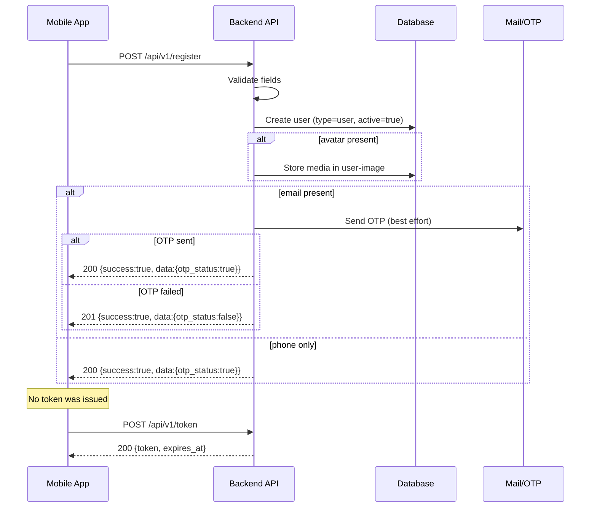
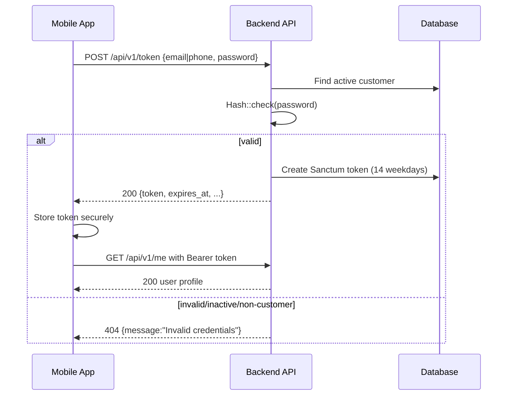
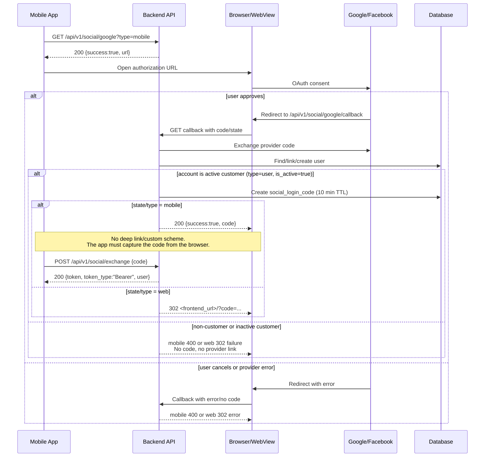
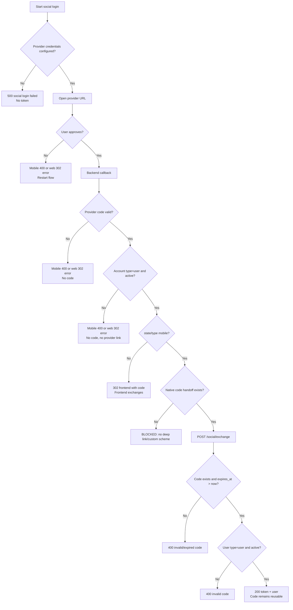

# Mobile Authentication API Guide

**Audience:** Mobile developers integrating the Meem commerce API  
**API version:** v1  
**Last verified:** 2026-11-16  
**Scope:** Customer mobile registration, normal login, and Google/Facebook social login

> **Scope note:** This guide covers customer mobile authentication only. Back-office authentication is intentionally excluded from the mobile contract and is not documented here. Email/phone OTP token issuance was also audited for the customer-only invariant; OTP endpoint contracts are outside this guide's endpoint reference.
>
> **Implementation note:** This guide reflects the approved customer-only mobile token rule implemented in this revision. No `.env`, provider console, database schema, or Admin Authentication behavior was changed.

---

## 1. Scope and Supported Authentication Methods

| Flow | Endpoints | Current Status |
|---|---|---|
| Registration | `POST /api/v1/register` | **AVAILABLE** |
| Normal login | `POST /api/v1/token` | **AVAILABLE** |
| Social login start | `GET /api/v1/social/redirect` or `GET /api/v1/social/{provider}` | **CONDITIONAL** — provider credentials required |
| Social callback | `GET /api/v1/social/{provider}/callback` | **CONDITIONAL** — provider-driven; native mobile handoff is **BLOCKED** |
| Social code exchange | `POST /api/v1/social/exchange` | **AVAILABLE** — requires a code from the callback |

### Status definitions

- **AVAILABLE** — Implemented, registered, and usable under the documented conditions.
- **CONDITIONAL** — Implemented, but depends on external configuration or a prerequisite.
- **BLOCKED** — The mobile app cannot complete the flow without a backend or architecture change.
- **NOT IMPLEMENTED** — No implementation exists.

### Customer-only mobile token invariant

All Mobile Authentication token issuance is **customer-only**:

```php
$user->type === 'user'
&& $user->is_active === true
```

This invariant is enforced server-side before issuing a token through:

- normal login
- social callback account resolution/linking
- social authorization-code exchange
- email OTP login
- phone OTP login

Admin and other non-customer accounts cannot obtain mobile tokens through social authentication or authorization-code exchange. Inactive customers cannot obtain mobile tokens. Admin Authentication itself is separate and remains unchanged.

The social callback and exchange handlers are shared with the web frontend. The approved customer-only check is applied at those shared token-issuance points; no separate web authentication code or admin authentication code was modified.

### Base URL

```text
https://<API_HOST>/api/v1
```

The `/api/v1` prefix is registered by `Marvel\Providers\RestApiServiceProvider::loadRoutes()`.

---

## 2. Endpoint Summary

| Method | Full API Path | Authentication Required | Intended for Mobile? | Status |
|---|---|---|---|---|
| `POST` | `/api/v1/register` | No | Yes | **AVAILABLE** |
| `POST` | `/api/v1/token` | No | Yes | **AVAILABLE** |
| `GET` | `/api/v1/social/redirect?provider=google` | No | Yes, to obtain the provider URL | **CONDITIONAL** |
| `GET` | `/api/v1/social/{provider}` | No | Yes, to obtain the provider URL | **CONDITIONAL** |
| `GET` | `/api/v1/social/{provider}/callback` | No | No direct call; provider/browser only | **CONDITIONAL / native handoff BLOCKED** |
| `POST` | `/api/v1/social/exchange` | No | Yes, after receiving a code | **AVAILABLE** |

All six endpoints are public. The authorization code or login credentials act as the credential.

---

## 3. Common Conventions

### 3.1 Headers

| Header | When Required | Notes |
|---|---|---|
| `Accept: application/json` | Recommended on every request | Ensures JSON error responses. |
| `Content-Type: application/json` | JSON request bodies | Not needed for GET requests. |
| `Content-Type: multipart/form-data` | Registration with `avatar` | The HTTP client generates the boundary. |
| `lang: en` or `lang: ar` | Optional | Missing header defaults to English. Unsupported values fall back to the application default (`ar`). |
| `Authorization: Bearer <token>` | Protected endpoints only | Not required by any endpoint in this guide. |

### 3.2 Middleware on all customer auth routes

```text
api
throttle:login        → App\Http\Middleware\BypassThrottle:login
lang                  → App\Http\Middleware\CheckLangMiddleware
```

`BypassThrottle` skips throttling when `config('app.disable_rate_limiting')` is true. The default is `true`, and the checked workspace resolves to `true`.

There is no active `RateLimiter::for('login')` and no active `RateLimiter::for('api')`. If rate limiting is enabled as-is, requests immediately return `429`. This is a **RISK** and is not changed by this documentation task.

### 3.3 Actual response envelopes

The API uses three response envelopes. Do not normalize them into one assumed standard.

| Producer | Shape | Used By |
|---|---|---|
| `Marvel\Traits\ApiResponse::apiResponse()` | `{"status": <integer>, "message": "<string>", "success": <boolean>, "data": {...}}` | `/register`, `/token` |
| `App\Exceptions\Handler` | `{"message": "<string>", "status": false, "success": false, "errors"?: {...}}` | Validation, 401, 429, 500 |
| `SocialController` direct responses | `{"success": true, "url": "..."}` / `{"success": true, "code": "..."}` / `{"success": true, "message": "...", "token": "...", "token_type": "Bearer", "user": {...}}` | `/social/*` |

`data` is omitted when empty. `errors` is present only for validation failures.

Use the HTTP status code and the `success` boolean as the primary signals. The `status` field is not always the same type.

### 3.4 Token summary

| Flow | Token Creation | Expiry | Response Field |
|---|---|---|---|
| Normal login | `createToken('auth_token', [], now()->addWeekdays(14))` | 14 business days, weekends skipped | `data.expires_at` |
| Social exchange | `createToken('auth_token')` | No expiry; `sanctum.expiration` is `null` | No `expires_at` field |

There is no refresh-token endpoint. Normal tokens must be renewed by logging in again.

### 3.5 Protected-endpoint authentication error

Protected endpoints return this when the Bearer token is missing or invalid:

```json
{
  "message": "Unauthenticated.",
  "status": false,
  "success": false
}
```

---

## 4. Endpoint Documentation

## 4.1 POST `/api/v1/register`

### 1. Endpoint

| Item | Value |
|---|---|
| HTTP method | `POST` |
| Full API path | `https://<API_HOST>/api/v1/register` |
| Authentication required | No |
| Intended for mobile use | Yes |
| Current status | **AVAILABLE** |

Source: `packages/marvel/src/Rest/Routes.php` L74; `UserController::register()` L722–770.

### 2. Purpose

Creates a customer account. The mobile app should call this when the user signs up with an email or phone number. Registration does **not** authenticate the user and does **not** return a token.

### 3. Request

**Headers**

```http
Accept: application/json
Content-Type: application/json
lang: en
```

For an avatar upload, use `multipart/form-data`.

**Body fields**

| Field | Type | Required | Validation / Notes |
|---|---|---|---|
| `first_name` | string | Yes | 2–50 characters. Combined into `name` as `"{first_name} {last_name}"`. |
| `last_name` | string | Yes | 2–50 characters. |
| `email` | string | No | Valid email; `email:rfc,dns`; unique in `users.email`. |
| `phone_number` | string | Yes | 10–20 characters; unique in `users.phone_number`. |
| `password` | string | Yes | 8–50 characters; must match `password_confirmation`. Hashed with `Hash::make()`. |
| `password_confirmation` | string | Yes | 8–50 characters. |
| `policy` | boolean or `1` | Yes | Consent flag. Accepted values: `1`, `"1"`, or `true`. |
| `avatar` | file | No | Image; `jpeg,png,jpg,gif,svg,webp`; maximum 2048 KB. Requires multipart. |

Do not send `name` or `permission`. They are not used by this request. Registration always creates a customer account.

**Example — JSON**

```http
POST /api/v1/register
Accept: application/json
Content-Type: application/json
lang: en
```

```json
{
  "first_name": "Mobile",
  "last_name": "User",
  "email": "mobile.user@gmail.com",
  "phone_number": "01000000002",
  "password": "Password123!",
  "password_confirmation": "Password123!",
  "policy": "1"
}
```

**Example — multipart with avatar**

```http
POST /api/v1/register
Accept: application/json
Content-Type: multipart/form-data; boundary=<generated>

first_name=Mobile
last_name=User
email=mobile.user@gmail.com
phone_number=01000000002
password=Password123!
password_confirmation=Password123!
policy=1
avatar=<image file>
```

### 4. Response

Success status is **200** or **201**. Both mean the account was created.

| Field | Type | Meaning |
|---|---|---|
| `status` | integer | `200` or `201`. |
| `message` | string | Localized status message. |
| `success` | boolean | `true`. |
| `data.otp_status` | boolean | `true` on normal completion; `false` only when OTP delivery failed. |
| `data.requires_resend` | boolean | Present only in the 201 OTP-failure path. |
| `data.email` | string | Present only in the 201 path. |
| `data.phone_number` | string | Present only in the 201 path. |

**Success — OTP sent or phone-only registration**

```json
{
  "status": 200,
  "message": "User registered successfully",
  "success": true,
  "data": {
    "otp_status": true
  }
}
```

**Success — account created, OTP delivery failed**

```json
{
  "status": 201,
  "message": "Account created successfully but failed to send verification code",
  "success": true,
  "data": {
    "requires_resend": true,
    "email": "mobile.user@gmail.com",
    "phone_number": "01000000002",
    "otp_status": false
  }
}
```

**Validation error — HTTP 422**

```json
{
  "message": "The given data was invalid.",
  "status": false,
  "success": false,
  "errors": {
    "email": [
      "The email has already been taken."
    ]
  }
}
```

**Rate limit — HTTP 429, conditional**

```json
{
  "message": "Too Many Attempts.",
  "status": false,
  "success": false
}
```

**Unexpected server/database error — HTTP 500**

```json
{
  "status": 500,
  "message": "Something went wrong.",
  "success": false
}
```

No internal exception text is returned. The exception is logged server-side.

### 5. Error Handling

| HTTP Status | Cause | Actual Example | Mobile Action |
|---|---|---|---|
| `422` | Missing/invalid field, duplicate email/phone, weak password, missing consent, invalid avatar | Validation envelope above | Show field-level errors from `errors`; correct input. |
| `429` | Rate limit exceeded, only when throttling is enabled | `{"message":"Too Many Attempts.","status":false,"success":false}` | Back off and retry later. |
| `500` | Database or unexpected server failure | `{"status":500,"message":"Something went wrong.","success":false}` | Show a generic error; retry later. |
| `401` / `403` | Not produced by this public endpoint | — | Not applicable. |

### 6. Backend Execution Flow

```text
POST /api/v1/register
→ api middleware
→ BypassThrottle:login (currently pass-through because rate limiting is disabled)
→ CheckLangMiddleware
→ UserCreateRequest validation
→ UserController@register
→ UserRepository::create
→ users table + optional user-image media
→ OTP notification (best effort)
→ ApiResponse
```

- Password is hashed with `Hash::make()`.
- No token is created.
- No default customer role is assigned by this path.
- If OTP delivery fails, the account remains created and the response is `201`.

### 7. Next Step

Call `POST /api/v1/token` with the same email or phone number and password. Do not expect the registration response to contain a token.

Mobile notes:

- **[VERIFIED]** `201` is a success path, not a failed registration.
- **[VERIFIED]** A phone-only registration sends no email OTP but still reports `otp_status: true`.
- **[VERIFIED]** The avatar is stored in the `user-image` media collection.
- **[VERIFIED]** No role is assigned during registration; `role` and `permissions` may be empty after login.
- **[RECOMMENDATION]** Use multipart only when an avatar is present.

---

## 4.2 POST `/api/v1/token`

### 1. Endpoint

| Item | Value |
|---|---|
| HTTP method | `POST` |
| Full API path | `https://<API_HOST>/api/v1/token` |
| Authentication required | No |
| Intended for mobile use | Yes |
| Current status | **AVAILABLE** |

Source: `packages/marvel/src/Rest/Routes.php` L75; `UserController::token()` L490–522.

### 2. Purpose

Authenticates an active customer and issues a Sanctum Bearer token. Call this after registration or when the user logs in.

### 3. Request

**Headers**

```http
Accept: application/json
Content-Type: application/json
lang: en
```

**Body fields**

| Field | Type | Required | Validation / Notes |
|---|---|---|---|
| `email` | string | Conditional | Required when `phone_number` is absent. Must be a valid email. |
| `phone_number` | string | Conditional | Required when `email` is absent. 8–15 characters. |
| `password` | string | Yes | Minimum 6 characters. |

At least one of `email` or `phone_number` must be present.

> **RISK:** Registration accepts phone lengths 10–20, while login accepts 8–15. A long registered phone number may fail login validation. This is not changed without approval.

**Example — email login**

```json
{
  "email": "mobile.user@gmail.com",
  "password": "Password123!"
}
```

**Example — phone login**

```json
{
  "phone_number": "01000000002",
  "password": "Password123!"
}
```

### 4. Response

| Field | Type | Meaning |
|---|---|---|
| `status` | integer | `200`. |
| `message` | string | `"User logged in successfully"`. |
| `success` | boolean | `true`. |
| `data.token` | string | Bearer token. Use as `Authorization: Bearer <token>`. |
| `data.email_verified` | boolean | Whether the email is verified. Login does not require verification. |
| `data.permissions` | array of strings | Permission names. May be empty. |
| `data.role` | array of strings | Role names. May be empty. |
| `data.expires_at` | ISO-8601 string | Token expiry. |
| `data.guest_cart_merge` | object | Optional; present only when a verified guest cart cookie was merged. |

**Success**

```json
{
  "status": 200,
  "message": "User logged in successfully",
  "success": true,
  "data": {
    "token": "<redacted-token>",
    "email_verified": false,
    "permissions": [],
    "role": [],
    "expires_at": "2026-12-04T11:08:29.000000Z"
  }
}
```

**Token lifetime:** 14 business days from issue. Use `data.expires_at`; do not calculate it locally.

**Invalid credentials — HTTP 404**

```json
{
  "status": 404,
  "message": "Invalid credentials",
  "success": false
}
```

This is also returned for inactive accounts and non-customer accounts.

**Validation error — HTTP 422**

```json
{
  "message": "The given data was invalid.",
  "status": false,
  "success": false,
  "errors": {
    "email": [
      "The email field is required when phone number is not present."
    ],
    "phone_number": [
      "The phone number field is required when email is not present."
    ],
    "password": [
      "The password field is required."
    ]
  }
}
```

**Rate limit — HTTP 429, conditional**

```json
{
  "message": "Too Many Attempts.",
  "status": false,
  "success": false
}
```

**Unexpected server failure — HTTP 500**

```json
{
  "message": "Internal Server Error",
  "status": false,
  "success": false
}
```

### 5. Error Handling

| HTTP Status | Cause | Actual Example | Mobile Action |
|---|---|---|---|
| `404` | Wrong password, unknown email/phone, inactive account, or non-customer account | `{"status":404,"message":"Invalid credentials","success":false}` | Show a generic invalid-credentials message. Do not treat 404 as a missing route. |
| `422` | Missing identifier, invalid email, short password | Validation envelope above | Show field errors. |
| `429` | Rate limit exceeded, only when throttling is enabled | `{"message":"Too Many Attempts.","status":false,"success":false}` | Back off and retry later. |
| `500` | Unexpected server failure | `{"message":"Internal Server Error","status":false,"success":false}` | Retry later. |
| `401` | Not produced by this public endpoint | — | A 401 is returned by protected endpoints when the Bearer token is missing/expired. |

### 6. Backend Execution Flow

```text
POST /api/v1/token
→ api middleware
→ BypassThrottle:login (currently pass-through because rate limiting is disabled)
→ CheckLangMiddleware
→ UserAuthEmailAndPasswordRequest validation
→ UserController@token
→ User query: type = user, is_active = true, email-or-phone match
→ customer-only check: type=user AND is_active=true
→ Hash::check(password)
→ UserCurrencyPreferenceService::adoptGuestCurrencyOnLogin
→ Sanctum createToken(..., now()->addWeekdays(14))
→ optional GuestCartMergeService
→ ApiResponse
```

- The token is a Sanctum personal access token.
- The token expires in 14 business days; weekends are skipped.
- Email verification is not required to log in.
- The response flag `email_verified` reports the current state only.

### 7. Next Step

Store the token securely and send it as `Authorization: Bearer <token>` on protected requests. A simple validation call is:

```http
GET /api/v1/me
Authorization: Bearer <token>
Accept: application/json
```

Mobile notes:

- **[VERIFIED]** `404` from this endpoint means invalid credentials, not a missing route.
- **[VERIFIED]** Only active accounts with `type=user` can obtain a token; inactive, admin, and other non-customer accounts are rejected without a token.
- **[VERIFIED]** Unverified users can obtain a token.
- **[VERIFIED]** `role` and `permissions` may be empty.
- **[VERIFIED]** There is no refresh-token endpoint.
- **[RECOMMENDATION]** Use Keychain/Keystore and never log the token.

---

## 4.3 GET `/api/v1/social/redirect`

### 1. Endpoint

| Item | Value |
|---|---|
| HTTP method | `GET` |
| Full API path | `https://<API_HOST>/api/v1/social/redirect?provider=google` |
| Authentication required | No |
| Intended for mobile use | Yes, to obtain the provider authorization URL |
| Current status | **CONDITIONAL** — provider credentials and callback URL required |

Source: `packages/marvel/src/Rest/Routes.php` L77; `SocialController::redirectFromQuery()` L47–50.

### 2. Purpose

Returns the Google/Facebook authorization URL. The mobile app should call this when the user chooses social login.

### 3. Request

**Query parameters**

| Parameter | Type | Required | Validation / Notes |
|---|---|---|---|
| `provider` | string | Yes | Exactly `google` or `facebook`, lowercase. |
| `type` | string | No | `web` (default) or `mobile`. Unknown values fall back to `web`. |

**Headers**

```http
Accept: application/json
lang: en
```

**Example**

```http
GET /api/v1/social/redirect?provider=google&type=mobile
Accept: application/json
lang: en
```

### 4. Response

**Success — HTTP 200**

```json
{
  "success": true,
  "url": "https://accounts.google.com/o/oauth2/auth?client_id=...&redirect_uri=...&response_type=code&state=mobile"
}
```

| Field | Type | Meaning |
|---|---|---|
| `success` | boolean | `true`. |
| `url` | string | Provider authorization URL. Open it in a browser/WebView. |

No token or authorization code is returned.

**Invalid or missing provider — HTTP 500**

```json
{
  "message": "Please login using Facebook or Google",
  "status": false,
  "success": false
}
```

**Missing/misconfigured callback URL — HTTP 500**

```json
{
  "message": "Social login failed, please try again.",
  "status": false,
  "success": false
}
```

**Rate limit — HTTP 429, conditional**

```json
{
  "message": "Too Many Attempts.",
  "status": false,
  "success": false
}
```

### 5. Error Handling

| HTTP Status | Cause | Actual Example | Mobile Action |
|---|---|---|---|
| `200` | Valid provider and configuration | `{"success":true,"url":"..."}` | Open `url` in a browser/WebView. |
| `500` | Missing/unsupported provider | `{"message":"Please login using Facebook or Google","status":false,"success":false}` | Fix the provider value. |
| `500` | Missing/misconfigured callback URL, non-string config, or HTTP callback in production | `{"message":"Social login failed, please try again.","status":false,"success":false}` | Report to backend; configuration is required. |
| `500` | Unexpected Socialite/provider error | `{"message":"Internal Server Error","status":false,"success":false}` | Report to backend. |
| `429` | Rate limit exceeded, only when throttling is enabled | `{"message":"Too Many Attempts.","status":false,"success":false}` | Back off. |

### 6. Backend Execution Flow

```text
GET /api/v1/social/redirect
→ api middleware
→ BypassThrottle:login (currently pass-through)
→ CheckLangMiddleware
→ SocialController@redirectFromQuery
→ SocialController@redirect
→ validateProvider(google|facebook)
→ Socialite driver
→ callbackUrl() from services.{provider}.redirect
→ with state = web|mobile
→ provider authorization URL
→ JSON response
```

No database write, token, or authorization code occurs here.

### 7. Next Step

Open the returned `url` in a browser/WebView. Do not expect an HTTP 302 from this endpoint.

Mobile notes:

- **[VERIFIED]** The response is JSON, not a redirect.
- **[VERIFIED]** Provider names are case-sensitive and must be lowercase.
- **[VERIFIED]** Invalid `type` values fall back to `web`.
- **[VERIFIED]** `state` only selects the response branch; it is not a random nonce.
- **[RECOMMENDATION]** Do not start social login until provider credentials are confirmed configured.

---

## 4.4 GET `/api/v1/social/{provider}`

### 1. Endpoint

| Item | Value |
|---|---|
| HTTP method | `GET` |
| Full API path | `https://<API_HOST>/api/v1/social/google` or `/api/v1/social/facebook` |
| Authentication required | No |
| Intended for mobile use | Yes, to obtain the provider authorization URL |
| Current status | **CONDITIONAL** — provider credentials and callback URL required |

Source: `packages/marvel/src/Rest/Routes.php` L79; `SocialController::redirect()` L27–42.

### 2. Purpose

Same as `/social/redirect`, but the provider is supplied in the path instead of the query string.

### 3. Request

| Parameter | Type | Required | Validation / Notes |
|---|---|---|---|
| `provider` | path string | Yes | Exactly `google` or `facebook`, lowercase. `Google` is invalid. |
| `type` | query string | No | `web` (default) or `mobile`. |

**Headers**

```http
Accept: application/json
lang: en
```

**Example**

```http
GET /api/v1/social/google?type=mobile
Accept: application/json
lang: en
```

### 4. Response

**Success — HTTP 200**

```json
{
  "success": true,
  "url": "https://accounts.google.com/o/oauth2/auth?client_id=...&redirect_uri=...&response_type=code&state=mobile"
}
```

The response contract is identical to `/social/redirect`.

**Invalid provider — HTTP 500**

```json
{
  "message": "Please login using Facebook or Google",
  "status": false,
  "success": false
}
```

**Missing/misconfigured callback URL — HTTP 500**

```json
{
  "message": "Social login failed, please try again.",
  "status": false,
  "success": false
}
```

**Rate limit — HTTP 429, conditional**

```json
{
  "message": "Too Many Attempts.",
  "status": false,
  "success": false
}
```

### 5. Error Handling

| HTTP Status | Cause | Actual Example | Mobile Action |
|---|---|---|---|
| `200` | Valid provider and configuration | `{"success":true,"url":"..."}` | Open `url`. |
| `500` | Invalid/unsupported provider | `{"message":"Please login using Facebook or Google","status":false,"success":false}` | Fix the path value. |
| `500` | Missing/misconfigured callback URL | `{"message":"Social login failed, please try again.","status":false,"success":false}` | Report to backend. |
| `500` | Unexpected Socialite/provider error | `{"message":"Internal Server Error","status":false,"success":false}` | Report to backend. |
| `429` | Rate limit exceeded, only when throttling is enabled | `{"message":"Too Many Attempts.","status":false,"success":false}` | Back off. |

### 6. Backend Execution Flow

```text
GET /api/v1/social/{provider}
→ api middleware
→ BypassThrottle:login (currently pass-through)
→ CheckLangMiddleware
→ SocialController@redirect
→ validateProvider(google|facebook)
→ Socialite driver
→ callbackUrl() from services.{provider}.redirect
→ with state = web|mobile
→ provider authorization URL
→ JSON response
```

No database write, token, or authorization code occurs here.

### 7. Next Step

Open the returned `url` in a browser/WebView. The literal `/social/redirect` route is declared before `/social/{provider}`, so it is not captured as a provider.

Mobile notes:

- **[VERIFIED]** Both redirect forms use the same controller logic.
- **[VERIFIED]** Only lowercase `google` and `facebook` are accepted.
- **[RECOMMENDATION]** Choose one redirect form and use it consistently.

---

## 4.5 GET `/api/v1/social/{provider}/callback`

> **Do not call this endpoint directly from the mobile app.** It is the OAuth provider callback. It expects the provider's authorization code and state.

### 1. Endpoint

| Item | Value |
|---|---|
| HTTP method | `GET` |
| Full API path | `https://<API_HOST>/api/v1/social/google/callback` or `/api/v1/social/facebook/callback` |
| Authentication required | No; the provider code is the credential |
| Intended for mobile use | No direct call; provider/browser only |
| Current status | **CONDITIONAL** — native mobile handoff is **BLOCKED** |

Source: `packages/marvel/src/Rest/Routes.php` L80; `SocialController::callback()` L59–171.

### 2. Purpose

Completes the provider OAuth exchange and creates a short-lived authorization code **only for an active customer (`type=user`, `is_active=true`)**. The callback either returns the code as JSON to the browser (`mobile`) or redirects the browser to the frontend with `?code=` (`web`). Non-customer and inactive accounts are rejected before provider linking and before code creation.

### 3. Request

The provider sends query parameters; the mobile app does not compose this request.

| Parameter | Type | Required | Notes |
|---|---|---|---|
| `code` | string | Yes on success | Provider authorization code. |
| `state` | string | Usually | Echoed by the provider; expected `web` or `mobile`. |
| `type` | string | No | If present, overrides `state`. |

No mobile-authored JSON body.

### 4. Response

**Mobile branch (`state=mobile` or `type=mobile`) — HTTP 200**

```json
{
  "success": true,
  "code": "<64-character-hex-authorization-code>"
}
```

| Field | Type | Meaning |
|---|---|---|
| `success` | boolean | `true`. |
| `code` | string | Authorization code to exchange. |

- The code is valid for **10 minutes by default** from creation.
- The code is **reusable** until expiry.
- The code is not an API token.

**Web branch (default) — HTTP 302**

```text
Location: <frontend_url>/?code=<authorization-code>
```

**Mobile branch failure — HTTP 400**

```json
{
  "success": false,
  "message": "Social login failed, please try again."
}
```

**Web branch failure — HTTP 302**

```text
Location: <frontend_url>/auth?error=social_login_failed
```

**Invalid provider — HTTP 500**

```json
{
  "message": "Please login using Facebook or Google",
  "status": false,
  "success": false
}
```

**Rate limit — HTTP 429, conditional**

```json
{
  "message": "Too Many Attempts.",
  "status": false,
  "success": false
}
```

### 5. Error Handling

| HTTP Status | Cause | Actual Example | Mobile Action |
|---|---|---|---|
| `200` | Mobile callback success | `{"success":true,"code":"..."}` | Capture the code and exchange it; native handoff is blocked. |
| `302` | Web callback success | `Location: <frontend_url>/?code=...` | Web frontend exchanges the code. |
| `400` | Provider error, cancellation, missing/invalid provider code, or Socialite error; mobile branch | `{"success":false,"message":"Social login failed, please try again."}` | Restart the social flow. |
| `400` | Existing account is not an active customer (`type=user`, `is_active=true`); mobile branch | `{"success":false,"message":"Social login failed, please try again."}` | Do not retry with the same account; use a customer account or contact support. |
| `302` | Provider error or cancellation; web branch | `Location: <frontend_url>/auth?error=social_login_failed` | Web frontend handles the error. |
| `302` | Existing account is not an active customer; web branch | `Location: <frontend_url>/auth?error=social_login_failed` | Web frontend handles the error. |
| `400` | Missing/misconfigured callback URL or HTTP callback in production; mobile branch | `{"success":false,"message":"Social login failed, please try again."}` | Report to backend. |
| `302` | Missing/misconfigured callback URL or HTTP callback in production; web branch | Failure redirect above | Backend configuration issue. |
| `500` | Invalid provider path | `{"message":"Please login using Facebook or Google","status":false,"success":false}` | Fix the provider. |
| `429` | Rate limit exceeded, only when throttling is enabled | `{"message":"Too Many Attempts.","status":false,"success":false}` | Back off. |

A database/service failure during user or code creation is caught and converted into the same mobile `400` / web `302` failure branch.

### 6. Backend Execution Flow

```text
GET /api/v1/social/{provider}/callback
→ api middleware
→ BypassThrottle:login (currently pass-through)
→ CheckLangMiddleware
→ SocialController@callback
→ validateProvider
→ clientType(): type, then state, default web
→ Socialite driver stateless()->redirectUrl(callbackUrl)->user()
→ Provider lookup by provider + provider_user_id
→ User::firstOrCreate(email) or User::create(no email)
→ customer-only check: type=user AND is_active=true
→ reject non-customer/inactive before provider link and code creation
→ providers updateOrCreate
→ SocialLoginCode::create(code, expires_at = now + 10 minutes)
→ mobile JSON or web redirect
```

No API token is issued in the callback. Non-customer or inactive accounts receive the generic social-login failure and no code.

### 7. Next Step

- **Web:** the frontend reads `?code=` and calls `/social/exchange`.
- **Mobile:** the browser receives JSON, but there is no deep link/custom scheme to deliver it to the app. Native mobile social login is **BLOCKED** until a handoff mechanism is approved.
- Do not call this endpoint directly to test the flow; it requires a real provider code.

Mobile notes:

- **[VERIFIED]** The mobile callback returns JSON in the browser.
- **[VERIFIED]** The code expires 10 minutes after creation.
- **[VERIFIED]** The code is reusable until expiry.
- **[VERIFIED]** The code is not deleted after exchange.
- **[VERIFIED]** Only active customers (`type=user`, `is_active=true`) can receive a callback code; non-customer/inactive accounts are rejected before linking.
- **[RISK]** No native mobile handoff exists.

---

## 4.6 POST `/api/v1/social/exchange`

### 1. Endpoint

| Item | Value |
|---|---|
| HTTP method | `POST` |
| Full API path | `https://<API_HOST>/api/v1/social/exchange` |
| Authentication required | No; the authorization code is the credential |
| Intended for mobile use | Yes, after receiving a code |
| Current status | **AVAILABLE** |

Source: `packages/marvel/src/Rest/Routes.php` L78; `SocialController::exchange()` L173–202.

### 2. Purpose

Exchanges a callback authorization code for a Sanctum Bearer token and a user object, but **only for an active customer (`type=user`, `is_active=true`)**. The exchange endpoint independently re-checks the account before issuing a token.

### 3. Request

**Headers**

```http
Accept: application/json
Content-Type: application/json
lang: en
```

**Body fields**

| Field | Type | Required | Validation / Notes |
|---|---|---|---|
| `code` | string | Yes | Maximum 64 characters. |

**Example**

```json
{
  "code": "<64-character-hex-authorization-code>"
}
```

### 4. Response

| Field | Type | Meaning |
|---|---|---|
| `success` | boolean | `true`. |
| `message` | string | `"Login successful."`. |
| `token` | string | Bearer token. |
| `token_type` | string | `"Bearer"`. |
| `user` | object | UserResource payload. |

**User object fields**

| Field | Type | Meaning |
|---|---|---|
| `id` | integer | User ID. |
| `name` | string | Display name. |
| `email` | string or null | Null if the provider returned no email. |
| `email_verified_at` | ISO-8601 string or null | Set for new social users with email; may be null for existing users. |
| `is_active` | integer | `1` or `0`. |
| `image` | string or null | Profile image URL. |
| `type` | string | Always `user` for a successful mobile exchange; non-customer accounts are rejected. |
| `phone_number` | string or null | Usually null for social users. |
| `created_at` | ISO-8601 string | Creation timestamp. |
| `updated_at` | ISO-8601 string | Last update timestamp. |
| `roles` | array | Role objects; may be empty. |
| `permissions` | array | Permission objects `{id,label}`; may be empty. |
| `address` | omitted | Only included when loaded; exchange loads only `roles`. |

**Success — HTTP 200**

```json
{
  "success": true,
  "message": "Login successful.",
  "token": "<redacted-token>",
  "token_type": "Bearer",
  "user": {
    "id": 1,
    "name": "Mobile User",
    "email": "mobile.user@gmail.com",
    "email_verified_at": "2026-11-16T11:08:29.000000Z",
    "is_active": 1,
    "image": null,
    "type": "user",
    "phone_number": null,
    "created_at": "2026-11-16T11:08:29.000000Z",
    "updated_at": "2026-11-16T11:08:29.000000Z",
    "roles": [],
    "permissions": []
  }
}
```

**Token lifetime:** the response has no `expires_at`; the token does not expire automatically. `config('sanctum.expiration')` is `null`.

**Invalid/expired code or ineligible user — HTTP 400**

Rejected user cases include inactive customers, non-customer accounts, and deleted users. No token is issued.

```json
{
  "success": false,
  "message": "Invalid or expired authorization code."
}
```

**Validation error — HTTP 422**

```json
{
  "message": "The given data was invalid.",
  "status": false,
  "success": false,
  "errors": {
    "code": [
      "The code field is required."
    ]
  }
}
```

**Rate limit — HTTP 429, conditional**

```json
{
  "message": "Too Many Attempts.",
  "status": false,
  "success": false
}
```

**Unexpected server failure — HTTP 500**

```json
{
  "message": "Internal Server Error",
  "status": false,
  "success": false
}
```

### 5. Error Handling

| HTTP Status | Cause | Actual Example | Mobile Action |
|---|---|---|---|
| `200` | Valid code and active customer | Success envelope above | Store the token; call protected APIs. |
| `400` | Unknown code, expired code, inactive customer, non-customer account, or deleted user | `{"success":false,"message":"Invalid or expired authorization code."}` | Restart social login; do not retry with an ineligible account. |
| `422` | Missing/non-string/too-long code | Validation envelope above | Fix the request. |
| `429` | Rate limit exceeded, only when throttling is enabled | `{"message":"Too Many Attempts.","status":false,"success":false}` | Back off. |
| `500` | Unexpected server failure | `{"message":"Internal Server Error","status":false,"success":false}` | Retry later. |
| `401` | Not produced by this public endpoint | — | An invalid code is `400`, not `401`. |

### 6. Backend Execution Flow

```text
POST /api/v1/social/exchange
→ api middleware
→ BypassThrottle:login (currently pass-through)
→ CheckLangMiddleware
→ SocialLoginExchangeRequest validation
→ SocialController@exchange
→ SocialLoginCode query: code match + expires_at > now()
→ User query: id + type = user + is_active = true
→ customer-only check: type=user AND is_active=true
→ reject ineligible user with 400 before token creation
→ Sanctum createToken('auth_token') with no expiry
→ UserResource
→ JSON response
```

- The code is not consumed, marked used, or deleted.
- Multiple exchanges of the same code before expiry produce multiple tokens for the same eligible customer.
- The token has no `expires_at`.
- The exchange endpoint independently enforces the customer-only invariant; it does not rely on the callback.

### 7. Next Step

Store the token and send it as `Authorization: Bearer <token>`. Because the social token has no expiry, the app should still support logout/revocation and secure storage.

Mobile notes:

- **[VERIFIED]** The endpoint accepts the exact code created by the callback.
- **[VERIFIED]** The code expires 10 minutes after creation.
- **[VERIFIED]** The code is reusable until expiry.
- **[VERIFIED]** The social token has no expiry.
- **[VERIFIED]** The endpoint independently rejects inactive customers and non-customer accounts with `400`; no token is issued.
- **[RECOMMENDATION]** Exchange the code once and store only the latest token.

---

## 5. Authentication Flows

### 5.1 Registration → Login



**Mobile operations:** submit registration, handle 200/201, then submit login.  
**Backend operations:** validation, user creation, optional media, OTP delivery, token issuance.  
**External operations:** mail/OTP delivery.

### 5.2 Normal Login → Token → Authenticated API



**Mobile operations:** submit credentials, store token, send Bearer header.  
**Backend operations:** credential verification and token generation.  
**External operations:** none.

### 5.3 Social Login → Callback → Code → Exchange → Token



**Mobile operations:** start the flow, open the URL, capture the code, exchange it, store the token.  
**Backend operations:** provider exchange, user resolution, code creation, token issuance.  
**External operations:** Google/Facebook authentication and consent.

### 5.4 Blocked and Failure Branches



---

## 6. Social Authorization Code: Verified Behavior

### 6.1 Is the 10-minute expiration implemented?

**Yes — VERIFIED and TESTED.**

- Callback creation: `SocialController::callback()` L116–121 sets `expires_at = now()->addMinutes(config('shop.social_login.code_ttl_minutes', 10))`.
- Config default: `packages/marvel/config/shop.php` L55 defaults `code_ttl_minutes` to `10`; the checked workspace resolves to `10`.
- Exchange enforcement: `SocialController::exchange()` L175–178 requires `expires_at > now()`.
- Test evidence: `SocialLoginFlowTest` verifies a code works before 10 minutes and returns `400` after 10 minutes.
- Ad-hoc probe: an expired code returned `400 {"success":false,"message":"Invalid or expired authorization code."}`.

At or after `expires_at`, the code is not accepted.

### 6.2 Are codes reusable or single-use?

**Reusable until expiry — VERIFIED and TESTED.**

- `exchange()` does not check `used` or `used_at`.
- `exchange()` does not delete, update, or consume the code row.
- `SocialLoginFlowTest::test_same_code_can_be_exchanged_multiple_times_with_distinct_tokens` confirms multiple successful exchanges.
- Ad-hoc probe exchanged the same code twice; both returned `200` with distinct tokens.

**Discrepancy:** the callback docblock says “single-use authorization code,” but the implementation is reusable. This is a **RISK** and requires an explicit product/security decision before changing.

### 6.3 Are codes deleted after exchange?

**No — VERIFIED and TESTED.**

`exchange()` has no delete/update operation. The row remains in `social_login_codes`; this guide found no exchange-time deletion path. Tests assert the row remains after exchange.

### 6.4 Does exchange accept the callback code?

**Yes — VERIFIED and TESTED.**

Callback creates `SocialLoginCode`; exchange queries the same model and database table. The code from the mobile callback can be posted directly to `/social/exchange`.

### 6.5 Do callback and exchange use the same storage?

**Yes — VERIFIED.**

Both use `Marvel\Database\Models\SocialLoginCode` with no custom connection. The migration is `database/migrations/2026_08_03_000002_create_social_login_codes_table.php`.

### 6.6 Is the callback URL static or request-derived?

**Static configuration — VERIFIED and TESTED.**

`callbackUrl()` reads `services.{provider}.redirect` and throws if missing. It does not derive the URL from the incoming Host header. Tests confirm that changing the Host header does not change `redirect_uri`.

### 6.7 Are Google/Facebook credentials configured?

**Not in the checked workspace — VERIFIED.**

- `packages/marvel/config/services.php` L33–43 reads environment values.
- Effective config probe: both client IDs and client secrets are **EMPTY**.
- Redirect URIs are set; the social frontend URL is empty.
- Production/staging configuration is **UNKNOWN**.

Social login cannot succeed end-to-end until credentials and the callback URI are configured.

### 6.8 Is native mobile OAuth handoff supported?

**No — VERIFIED; native mobile flow is BLOCKED.**

For `type=mobile`, the callback returns JSON in the browser. There is no deep link, universal link, or custom URL scheme to deliver the code to the app. WebView interception is not a documented contract.

### 6.9 Is the customer-only invariant enforced on every token path?

**Yes — VERIFIED and TESTED for the mobile-reachable paths.**

| Mobile token path | Enforcement | Evidence |
|---|---|---|
| Normal login `POST /token` | Lookup is restricted to `type=user` and `is_active=true`, plus an explicit eligibility check before `createToken`. | `UserController::token()`; `AuthenticationTest` active/inactive/admin/vendor tests. |
| Social callback / account linking | Existing provider-linked user and email-linked user are checked for `type=user` and active status **before** provider linking and before code creation. | `SocialController::callback()`; `SocialLoginFlowTest` admin/vendor/inactive callback tests. |
| Social exchange `POST /social/exchange` | User lookup is restricted to `type=user` and `is_active=true`, plus an independent eligibility check immediately before `createToken`. | `SocialController::exchange()`; `SocialLoginFlowTest` admin/vendor/inactive exchange tests. |
| Email OTP login `POST /otp-login` with `email` | Lookup is restricted to `type=user` and `is_active=true`. | `UserController::verifyLoginOtp()`; `OtpEmailCustomerOnlyTest`. |
| Phone OTP login `POST /otp-login` with `phone_number` | Lookup is restricted to `type=user` and `is_active=true`. | `UserController::otpLogin()`; `OtpLocalLoginTest` admin/vendor/inactive tests. |
| Legacy direct social access-token method | Eligibility check is applied before provider linking and token creation. This method has no registered route in the current route table. | `UserController::socialLogin()`; no route found. |

In all rejected cases, no `personal_access_tokens` row is created.

---

## 7. Findings Classification

| ID | Classification | Finding | Evidence |
|---|---|---|---|
| F-01 | **VERIFIED** | All customer auth routes use `api`, `throttle:login`, and `lang`. | `php artisan route:list --path=api/v1 -v`; `Routes.php` L73–80. |
| F-02 | **VERIFIED** | Registration creates a customer user and does not issue a token. | `UserController::register()` L722–770. |
| F-03 | **VERIFIED** | Registration hashes the password with `Hash::make()` and assigns no default role. | `register()`; probe `roles=[]`. |
| F-04 | **VERIFIED** | Registration OTP failure still creates the account and returns `201`. | `register()` inner catch; probe returned 201. |
| F-05 | **VERIFIED** | Normal login accepts email or phone and restricts lookup to `type = user` and `is_active = true`. | `token()` L490–497. |
| F-06 | **VERIFIED** | Normal login does not require email verification. | `token()`; probe returned `email_verified:false` with a token. |
| F-07 | **VERIFIED** | Normal tokens expire in 14 business days. | `token()` `addWeekdays(14)`; probe DB expiry 2026-12-04 from 2026-11-16. |
| F-08 | **VERIFIED** | Social authorization codes expire 10 minutes after creation by default. | `callback()` `expires_at` creation; `shop.php` L55. |
| F-09 | **VERIFIED** | Exchange rejects codes where `expires_at <= now()`. | `exchange()` expiry query. |
| F-10 | **VERIFIED** | Exchange does not delete, mutate, or consume the code. | `exchange()`; tests. |
| F-11 | **VERIFIED** | Social exchange tokens have no expiry. | `exchange()` `createToken` without expiry; `sanctum.expiration` null; probe `expires_at=NULL`. |
| F-12 | **VERIFIED** | Callback URL is static configuration, not request-host-derived. | `callbackUrl()`; host-header tests. |
| F-13 | **VERIFIED** | Native mobile OAuth handoff is absent. | `callback()` mobile JSON branch; no deep link/custom scheme. |
| F-14 | **VERIFIED** | Provider credentials are empty in the checked environment. | Effective config probe; `services.php` L33–43. |
| F-15 | **VERIFIED** | `throttle:login` and `throttle:api` are not registered. | Config probe; commented limiters in providers. |
| F-16 | **TESTED** | Registration success/validation works. | `AuthenticationTest` 23/23. |
| F-17 | **TESTED** | Social callback, code creation, expiry, exchange, and reuse work as described. | `SocialLoginFlowTest` 29/29; `SocialRoutesCallbackContractTest` 19/19. |
| F-18 | **TESTED** | Expired code returns `400`; same code can be exchanged twice for an active customer. | Ad-hoc probe; `SocialLoginFlowTest` reuse test. |
| F-19 | **TESTED** | Normal token expiry is 14 weekdays; social token expiry is null. | Ad-hoc probe DB values. |
| F-20 | **TESTED** | With `disable_rate_limiting=false`, auth returns `429`. | Ad-hoc probe. |
| F-21 | **INFERRED** | A native app cannot automatically receive the callback JSON code. | No deep link/custom scheme in source; browser JSON response. |
| F-22 | **INFERRED** | Empty provider credentials will cause provider rejection. | Socialite builds the URL with empty `client_id`; provider behavior is external. |
| F-23 | **UNKNOWN** | Production/staging provider credentials and frontend URL. | External configuration not available. |
| F-24 | **UNKNOWN** | Production rate-limiting setting. | Environment not available. |
| F-25 | **UNKNOWN** | Real provider cancellation behavior. | Requires live credentials and interactive consent. |
| F-26 | **VERIFIED** | Social callback rejects non-customer/inactive accounts before provider linking or code creation. | `SocialController::callback()` customer-only check; `SocialLoginFlowTest` admin/vendor/inactive callback tests. |
| F-27 | **RISK** | Codes are reusable despite the “single-use” docblock. | `exchange()` ignores `used`; tests confirm reuse. |
| F-28 | **RISK** | Social exchange tokens do not expire. | No third argument to `createToken`; Sanctum expiration null. |
| F-29 | **RISK** | Native social login is blocked by missing code handoff. | No deep link/custom scheme. |
| F-30 | **RISK** | Rate limiting is not functional and enabling it as-is returns 429. | No limiters registered; probe returned 429. |
| F-31 | **RISK** | Invalid provider returns `500`, not `400`/`422`. | `validateProvider()` throws `MarvelException`; handler returns 500. |
| F-32 | **RISK** | Three response envelopes require three parsers. | ApiResponse, Handler, SocialController responses. |
| F-33 | **RISK** | Registration phone length 10–20 and login phone length 8–15 differ. | `UserCreateRequest` L34; `UserAuthEmailAndPasswordRequest` L31. |
| F-34 | **RISK** | Normal login permits unverified email users. | `token()` does not check `hasVerifiedEmail()`. |
| F-35 | **RISK** | `state` is not a random CSRF nonce. | `clientType()` accepts only `web`/`mobile`. |
| F-36 | **VERIFIED** | Normal login, social callback, social exchange, email OTP, and phone OTP enforce `type=user` and active status before token creation. | `UserController::token/verifyLoginOtp/otpLogin/socialLogin`; `SocialController::callback/exchange`; focused tests. |
| F-37 | **TESTED** | Admin, vendor, and inactive accounts are rejected without a token on normal login, social callback, social exchange, and both OTP paths. | `AuthenticationTest` 23/23; `SocialLoginFlowTest` 29/29; `OtpLocalLoginTest` 7/7; `OtpEmailCustomerOnlyTest` 4/4. |
| F-38 | **VERIFIED** | The legacy direct social access-token method has no registered route; it still applies the eligibility check. | Route list; `UserController::socialLogin()`. |

---

## 8. Error Handling Guide

Use the HTTP status code first, then read the response envelope.

| HTTP Status | Typical Meaning | Mobile Handling |
|---|---|---|
| `200` | Success | Parse the endpoint-specific success fields. |
| `201` | Registration succeeded but OTP delivery failed | Treat as account-created; continue to login. |
| `302` | Web social callback redirect | Web frontend handles it; native HTTP clients should not blindly follow it. |
| `400` | Social callback failure, ineligible social account, or invalid/expired social code | Restart the social flow; do not retry with a non-customer/inactive account. |
| `401` | Protected endpoint: missing/invalid Bearer token | Clear the token and restart login. |
| `404` | Normal login: invalid credentials | Map to a generic login error; do not treat as a missing route. |
| `422` | Validation failure | Display `errors` next to the relevant fields. |
| `429` | Rate limit exceeded, only when throttling is enabled | Back off and retry later. |
| `500` | Server/configuration/provider failure | Show a generic error; report with a request ID. |

Important rules:

- `404` on `/token` means invalid credentials, not a missing endpoint.
- A social authorization code failure is `400`, not `401`.
- `401` applies to protected endpoints, not to the public auth endpoints.
- `429` is conditional because rate limiting is currently disabled and its limiter is not registered.
- Unhandled `500` messages may expose raw exception text when `APP_DEBUG=true`; production should use debug mode disabled.
- Registration `500` responses now return a generic message and do not include internal exception text.

## 9. Token Usage for Normal Mobile Requests

After normal login or social exchange, send:

```http
GET /api/v1/me
Authorization: Bearer <token>
Accept: application/json
lang: en
```

If the token is missing or invalid, protected endpoints return:

```json
{
  "message": "Unauthenticated.",
  "status": false,
  "success": false
}
```

Rules:

- **[VERIFIED]** Normal tokens expire in 14 business days.
- **[VERIFIED]** Social exchange tokens have no expiry.
- **[VERIFIED]** There is no refresh-token endpoint.
- **[RECOMMENDATION]** Store tokens in Keychain/Keystore.
- **[RECOMMENDATION]** Never log tokens or authorization codes.
- **[RECOMMENDATION]** On `401`, clear the token and restart login.

---

## 10. Testing and Verification

### 10.1 Environment

Focused tests were run with an isolated in-memory SQLite database:

```powershell
$env:DB_CONNECTION='sqlite'
$env:DB_DATABASE=':memory:'
php vendor/bin/phpunit <test-file>
```

No migrations, seeders, or destructive database operations were run.

### 10.2 PASSED

| Command / Test | Result |
|---|---|
| `php vendor/bin/phpunit tests/Feature/AuthenticationTest.php` | **23 tests, 63 assertions — OK** |
| `php vendor/bin/phpunit tests/Feature/SocialLoginFlowTest.php` | **29 tests, 114 assertions — OK** |
| `php vendor/bin/phpunit tests/Feature/SocialRoutesCallbackContractTest.php` | **19 tests, 75 assertions — OK** |
| `php vendor/bin/phpunit tests/Feature/Rest/OtpLocalLoginTest.php` | **7 tests, 17 assertions — OK** |
| `php vendor/bin/phpunit tests/Feature/Rest/OtpEmailCustomerOnlyTest.php` | **4 tests, 12 assertions — OK** |
| `php artisan route:list --path=api/v1 -v` | Customer auth routes resolve with `api`, `throttle:login`, and `lang`. |

Ad-hoc probes (temporary, not committed) confirmed:

- Registration returned `201` when OTP delivery failed.
- Normal login returned `200` with `email_verified:false` for an active customer.
- Normal token expiry was 14 weekdays.
- Social exchange accepted the same code twice with distinct tokens for an active customer.
- Social token `expires_at` was `NULL`.
- Expired code returned `400`.
- With `disable_rate_limiting=false`, auth returned `429`.

Customer-only regression tests confirmed:

- Active customer: token issuance still succeeds on normal login and social exchange.
- Inactive customer: no token on normal login, social callback, social exchange, email OTP, or phone OTP.
- Admin account: no mobile token on normal login, social callback, social exchange, email OTP, or phone OTP.
- Other non-customer type: no mobile token on the same paths.
- Social callback does not create a provider link or authorization code for rejected accounts.

### 10.3 FAILED

| Command / Test | Result | Reason |
|---|---|---|
| Full `php artisan test` | **Not run to completion** | The suite currently stops on an unrelated parse error in `tests/Feature/BannerApiTest.php` line 612. Focused tests were run individually. |

### 10.4 NOT TESTED

| Item | Reason |
|---|---|
| Live Google OAuth | Client ID/secret are empty in the checked environment. |
| Live Facebook OAuth | Client ID/secret are empty in the checked environment. |
| Real OTP email delivery | No real inbox is available in the test environment. |
| Production/staging configuration | External configuration is not available. |
| Native mobile handoff | No handoff mechanism exists. |
| Real provider cancellation | Requires live credentials and interactive consent. |

---

## 11. Source References

| Behavior | Source |
|---|---|
| Customer auth route definitions | `packages/marvel/src/Rest/Routes.php` L73–75, L77–80 |
| `/api/v1` prefix | `packages/marvel/src/Providers/RestAPIServiceProvider.php` L27–32 |
| Registration | `packages/marvel/src/Http/Controllers/UserController.php::register()` L722–770 |
| Normal login | `UserController::token()` L490–522 |
| Registration validation | `packages/marvel/src/Http/Requests/UserCreateRequest.php` L30–39 |
| Login validation | `packages/marvel/src/Http/Requests/UserAuthEmailAndPasswordRequest.php` L29–33 |
| Social redirect/callback/exchange | `packages/marvel/src/Http/Controllers/SocialController.php` L27–314 |
| Customer-only social helper | `SocialController::isEligibleMobileCustomer()` |
| Customer-only login/OTP helpers | `UserController::isEligibleMobileCustomer()`, `verifyLoginOtp()`, `otpLogin()`, `socialLogin()` |
| Social exchange validation | `packages/marvel/src/Http/Requests/SocialLoginExchangeRequest.php` L14–18 |
| Response envelope | `packages/marvel/src/Traits/ApiResponse.php` L9–21 |
| Exception envelope | `app/Exceptions/Handler.php` L100–257 |
| UserResource | `packages/marvel/src/Http/Resources/UserResource.php` L15–32 |
| User media collection | `packages/marvel/src/Database/Models/User.php` L374–377 |
| Social code model | `packages/marvel/src/Database/Models/SocialLoginCode.php` |
| Social code migration | `database/migrations/2026_08_03_000002_create_social_login_codes_table.php` |
| Provider migration | `database/migrations/2026_08_03_000001_create_providers_table.php` |
| Provider config | `packages/marvel/config/services.php` L33–43 |
| Effective services config | `packages/marvel/src/ShopServiceProvider.php` L218–236 |
| Social frontend/TTL config | `packages/marvel/config/shop.php` L50–56 |
| Rate-limit bypass | `app/Http/Middleware/BypassThrottle.php` L23–30 |
| Inactive login limiter | `app/Providers/AppServiceProvider.php` L112–122 (commented) |
| Inactive API limiter | `app/Providers/RouteServiceProvider.php` L48, L57–120 |
| Language middleware | `app/Http/Middleware/CheckLangMiddleware.php` L26–52 |
| Sanctum expiration | `packages/marvel/config/sanctum.php` L30 |
| Auth tests | `tests/Feature/AuthenticationTest.php` |
| Social flow tests | `tests/Feature/SocialLoginFlowTest.php` |
| Social route/callback tests | `tests/Feature/SocialRoutesCallbackContractTest.php` |
| Phone OTP tests | `tests/Feature/Rest/OtpLocalLoginTest.php` |
| Email OTP tests | `tests/Feature/Rest/OtpEmailCustomerOnlyTest.php` |

---

## 12. Mobile Developer Integration Steps

1. Use `https://<API_HOST>/api/v1` as the base path.
2. Send `Accept: application/json` and `lang: en` or `lang: ar` on every request.
3. Register with `POST /api/v1/register`.
4. Treat both `200` and `201` registration responses as account-created.
5. Do not expect a token from registration; call `POST /api/v1/token`.
6. Send email or phone plus password to `/token`.
7. Treat `404` from `/token` as invalid credentials, not a missing route.
8. Store the returned token in Keychain/Keystore.
9. Send `Authorization: Bearer <token>` on protected requests.
10. Use `data.expires_at` for normal tokens; do not calculate expiry locally.
11. There is no refresh-token flow; log in again after expiry.
12. To start social login, call `GET /api/v1/social/google?type=mobile` or `GET /api/v1/social/facebook?type=mobile`.
13. Open the returned `url` in a browser or secure WebView.
14. Do not call `/social/{provider}/callback` directly.
15. Native mobile social login is currently **BLOCKED** because the callback returns JSON in the browser and no deep link/custom scheme exists.
16. If a supported WebView/code-handoff contract is approved later, send the code to `POST /api/v1/social/exchange`.
17. Social codes expire 10 minutes after creation and are reusable until expiry.
18. Social exchange tokens have no expiry; still store them securely and support logout.
19. Never log tokens, authorization codes, passwords, or OTPs.
20. On `401` from a protected endpoint, clear the token and restart login.
21. Only active accounts with `type=user` are eligible for mobile tokens. Admin, other non-customer, and inactive accounts are rejected without a token on normal login, social flows, and OTP flows.
22. Do not attempt to use a social code or OTP for an account that does not satisfy the customer-only invariant.
