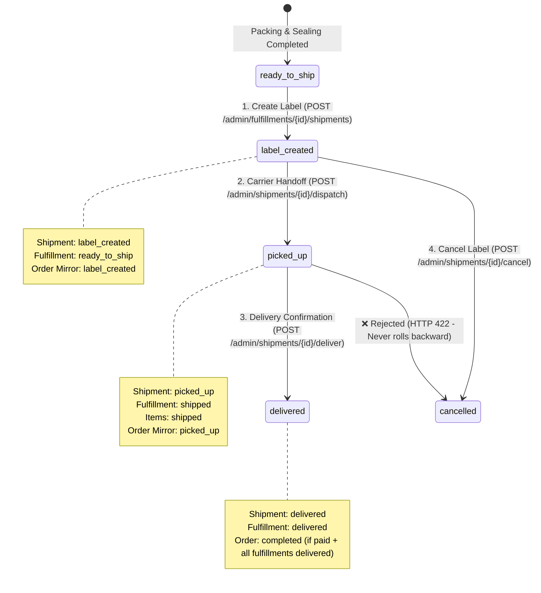

# WMS Shipment & Carrier Dispatch Module — Mobile Integration Guide (Phase 9)

A comprehensive integration and use-case guide for mobile development teams (Flutter, React Native, iOS, Android, and Handheld PDA Scanners) to integrate with the Warehouse Management System (WMS) Shipment & Carrier Dispatch APIs.

---

## 1. High-Level Flow & State Machine



---

## 2. Mobile UI Button Matrix & Guard Rules

| Shipment Status (`status`) | Fulfillment Status | Allowed Actions on Mobile Screen | Disabled / Forbidden Actions |
| :--- | :--- | :--- | :--- |
| **No Shipment Yet** | `ready_to_ship` | **"Create Shipping Label"** | Dispatch, Deliver, Cancel |
| `label_created` | `ready_to_ship` | **"Handover to Driver (Dispatch)"**<br>**"Cancel Shipment"** | Create New Label (One active label invariant) |
| `picked_up` | `shipped` | **"Mark Delivered (Customer Received)"** | Cancel Shipment (Locked once physically in transit) |
| `delivered` | `delivered` | **View Details Only (Finished)** | All mutation actions |
| `cancelled` | `ready_to_ship` | **"Re-create Shipping Label"** | Dispatch, Deliver |

---

## 3. Endpoints & Use Cases

### Base URL & Common Headers
All WMS shipment endpoints require Sanctum authentication and JSON headers:
```http
Authorization: Bearer {token}
Accept: application/json
Content-Type: application/json
```

---

### Use Case 1: Create Shipping Label for Ready Fulfillment
* **Screen:** Fulfillment Details Screen (when all packages are sealed and weighed).
* **Precondition:** `fulfillment.status === 'ready_to_ship'`.
* **Endpoint:** `POST /api/v1/admin/fulfillments/{id}/shipments`
* **Permission:** `wms-shipments.create`

#### Request Payload
```json
{
  "courier": "Aramex",
  "shipping_method": "Express Delivery",
  "notes": "Handle with care - Glass items",
  "idempotency_key": "SHIP-FULFILLMENT-15-RETRY-01",
  "destination_address": {
    "street": "123 Tahrir Street",
    "city": "Cairo",
    "phone": "+201000000001"
  }
}
```

#### Success Response (HTTP 201 Created / 200 Replay)
```json
{
  "status": 201,
  "message": "Shipment created successfully",
  "success": true,
  "data": {
    "id": 42,
    "uuid": "9c123456-789a-bcde-f012-3456789abcde",
    "order_id": 105,
    "fulfillment_id": 15,
    "tracking_number": "TRK-2026-00042",
    "courier": "Aramex",
    "status": "label_created",
    "shipping_method": "Express Delivery",
    "shipping_cost": null,
    "total_weight": null,
    "created_at": "2026-11-08T14:10:00+02:00"
  }
}
```

#### Error Handling
* `422 Unprocessable Entity`: Fulfillment is not `ready_to_ship` (e.g. still in `picking` or `packing`).
* `409 Conflict`: Active shipment already exists for this fulfillment (unless replaying with identical `idempotency_key`).

---

### Use Case 2: Bulk Create Shipping Labels
* **Screen:** Ready To Ship Orders List (Multi-Select).
* **Endpoint:** `POST /api/v1/admin/fulfillments/create-shipments`
* **Permission:** `wms-shipments.bulk-create`

#### Request Payload
```json
{
  "fulfillment_ids": [15, 16, 17],
  "courier": "Bosta",
  "shipping_method": "Standard",
  "notes": "Bulk dispatch batch #4"
}
```

#### Success Response (HTTP 200 OK — Fault Tolerant)
```json
{
  "status": 200,
  "message": "Shipments created successfully",
  "success": true,
  "data": {
    "successful": [
      {
        "fulfillment_id": 15,
        "fulfillment_number": "FUL-2026-00015",
        "shipment_id": 42,
        "tracking_number": "TRK-42",
        "status": "label_created"
      },
      {
        "fulfillment_id": 16,
        "fulfillment_number": "FUL-2026-00016",
        "shipment_id": 43,
        "tracking_number": "TRK-43",
        "status": "label_created"
      }
    ],
    "failed": [
      {
        "fulfillment_id": 17,
        "reason": "Fulfillment #17 status is packing (must be ready_to_ship)"
      }
    ],
    "summary": {
      "total": 3,
      "succeeded": 2,
      "failed": 1
    }
  }
}
```

---

### Use Case 3: Carrier Handoff / Dispatch (Single Parcel)
* **Screen:** Shipping Dock / Handheld Scanner (Scan parcel barcode and handover to driver).
* **Precondition:** `shipment.status === 'label_created'`.
* **Endpoint:** `POST /api/v1/admin/shipments/{id}/dispatch`
* **Permission:** `wms-shipments.dispatch`

#### Request Payload
```json
{
  "notes": "Handed to driver Ahmed - Van Plate 1234"
}
```

#### Background State Changes
1. `Shipment.status`: Transitions `label_created` ➔ `picked_up`. Stamps `shipped_at = now()`.
2. `Fulfillment.status`: Transitions `ready_to_ship` ➔ `shipped`.
3. `FulfillmentItem.status`: Updated to `shipped`.
4. `Order.shipment_status`: Updated to `picked_up`.

#### Success Response (HTTP 200 OK)
```json
{
  "status": 200,
  "message": "Shipment dispatched successfully",
  "success": true,
  "data": {
    "id": 42,
    "status": "picked_up",
    "shipped_at": "2026-11-08T14:15:00+02:00",
    "notes": "Handed to driver Ahmed - Van Plate 1234"
  }
}
```

---

### Use Case 4: Bulk Carrier Handoff / Dispatch
* **Screen:** Shipping Dock Continuous Barcode Scanner (operator scans 10-50 parcels consecutively into a list).
* **Endpoint:** `POST /api/v1/admin/shipments/bulk-dispatch`
* **Permission:** `wms-shipments.bulk-dispatch`

#### Request Payload
```json
{
  "shipment_ids": [42, 43, 44],
  "notes": "Dispatched via Aramex truck #9"
}
```

---

### Use Case 5: Delivery Confirmation (Single Parcel)
* **Screen:** Courier Delivery App / Customer Support Override.
* **Precondition:** `shipment.status` is one of `['picked_up', 'in_transit', 'out_for_delivery']`.
* **Endpoint:** `POST /api/v1/admin/shipments/{id}/deliver`
* **Permission:** `wms-shipments.deliver`

#### Request Payload
```json
{
  "notes": "Delivered to customer in person. Cash collected."
}
```

#### Background State Changes
1. `Shipment.status`: Walks `picked_up` ➔ `in_transit` ➔ `out_for_delivery` ➔ `delivered`. Stamps `delivered_at = now()`.
2. `Fulfillment.status`: Transitions `shipped` ➔ `delivered`.
3. `Order Completion Check`: If order payment is complete (`paid`) AND all fulfillments are `delivered`, `orders.status` is automatically updated to `completed`!

#### Success Response (HTTP 200 OK)
```json
{
  "status": 200,
  "message": "Shipment marked delivered successfully",
  "success": true,
  "data": {
    "id": 42,
    "status": "delivered",
    "delivered_at": "2026-11-08T14:20:00+02:00",
    "notes": "Delivered to customer in person. Cash collected."
  }
}
```

---

### Use Case 6: Bulk Delivery Confirmation
* **Screen:** Bulk carrier manifest import or driver end-of-route batch reconciliation.
* **Endpoint:** `POST /api/v1/admin/shipments/bulk-deliver`
* **Permission:** `wms-shipments.bulk-deliver`

#### Request Payload
```json
{
  "shipment_ids": [42, 43, 44],
  "notes": "Route #12 completed deliveries"
}
```

---

### Use Case 7: Cancel Shipment Label
* **Screen:** Shipment Details screen (Operator needs to cancel label due to carton damage or customer address modification before pickup).
* **Precondition:** Shipment must NOT be in `picked_up` or `delivered` state.
* **Endpoint:** `POST /api/v1/admin/shipments/{id}/cancel`
* **Permission:** `wms-shipments.cancel`

#### Request Payload
```json
{
  "reason": "Carton damaged before carrier pickup. Re-packing required."
}
```

#### Background State Changes
* `Shipment.status`: Transitions to `cancelled`.
* Records audit fields: `cancelled_at = now()`, `cancelled_by = auth()->id()`, `cancel_reason`, `cancel_source = 'admin_api'`.
* Retains the record for auditing. Fulfillment status is NOT moved backward; operator can re-pack and create a fresh label.

#### Success Response (HTTP 200 OK)
```json
{
  "status": 200,
  "message": "Shipment cancelled successfully",
  "success": true,
  "data": {
    "id": 42,
    "status": "cancelled",
    "cancel_reason": "Carton damaged before carrier pickup. Re-packing required.",
    "cancelled_at": "2026-11-08T14:22:00+02:00"
  }
}
```

---

### Use Case 8: List & Search Shipments
* **Screen:** Shipments Management List.
* **Endpoint:** `GET /api/v1/admin/shipments`
* **Permission:** `wms-shipments.index`
* **Supported Query Filters:**
  * `status`: Filter by state (`label_created`, `picked_up`, `delivered`, `cancelled`).
  * `fulfillment_id`: Filter by fulfillment ID.
  * `warehouse_id`: Filter by warehouse (for global admins).
  * `limit`: Page size (default 15, max 100).
  * `page`: Page number.

#### Example Request
```http
GET /api/v1/admin/shipments?status=label_created&limit=20&page=1
```

---

### Use Case 9: View Single Shipment Details
* **Screen:** Shipment Overview & Tracking Modal.
* **Endpoint:** `GET /api/v1/admin/shipments/{id}`
* **Permission:** `wms-shipments.show`

---

## 4. Mobile Error Codes & Action Table

| HTTP Status | Error Type | Cause | Recommended Mobile Action |
| :--- | :--- | :--- | :--- |
| **`401`** | `Unauthorized` | Bearer token expired or invalid. | Redirect user to Login Screen (`/admin-login`). |
| **`403`** | `Forbidden` | Missing Spatie permission for this action. | Show alert: *"You do not have permission to perform this logistics operation."* |
| **`404`** | `Not Found` | Shipment ID does not exist or belongs to another warehouse. | Show alert: *"Shipment not found or belongs to a different warehouse."* |
| **`409`** | `Conflict` | Active label already exists for this fulfillment. | Refresh view and display existing label instead of re-creating. |
| **`422`** | `Unprocessable` | State machine constraint violated (e.g. dispatching unsealed carton or cancelling dispatched order). | Display server error message directly in Toast / SnackBar. |

