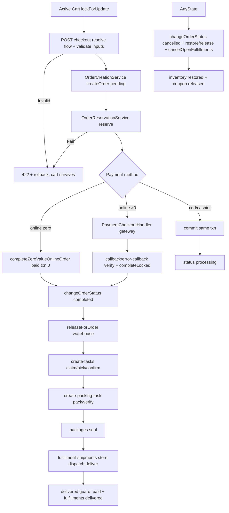

# Flow Contract — VERIFIED (source-of-truth)

> Built from VERIFIED code + schema + Agent E/F evidence. No new business rules invented. Ambiguities are marked BLOCKED/UNKNOWN, not resolved by redesign.

## 1. What creates an order
- Entry: `POST api/v1/general/checkout` → `App\Http\Controllers\Api\General\OrderController@checkout` (OrderController.php:142-211) validates via `Marvel\Http\Requests\OrderCreateRequest`, loads active cart (`CartInventoryService::getActiveCartForUser`), delegates to `App\Services\General\OrderService::addItemsInOrder` inside ONE `DB::transaction` (OrderService.php:212).
- Writes on create (`OrderCreationService::createOrder`, OrderCreationService.php:31-180):
  - `orders`: `status=pending`, `payment_status=pending`, `fulfillment_status=pending`, totals rounded to catalog exponent, currency snapshot (`currency_code/base/catalog/rate/rate_date/converted_total`), pickup snapshot, `shipping_type` (default `local` via normalize), `flow_id/flow_code`, address/governorate/coupon/promotion columns. `assignFlowToOrder` + `recordStatusChange(null→pending)` if history table exists.
  - `order_products` via `createOrderItems/syncOrderItems` (265-434).
  - `order_flow_values` via `persistValidatedValues(checkout)` — only validated dynamic inputs.
  - Reservation: `OrderReservationService::reserveForOrder` — on failure aborts txn, cart survives. COD/cashier with physical lines → `commit(order)` same txn (idempotent re-commit on completed later).
  - Post-commit: `finalizeOrder` dispatches `OrderCreated` (after commit semantics; listeners never see unreserved order).
- Fast-shipping checkout: `POST api/v1/general/fast-shipping/checkout` → `FastShippingController@checkout` (separate path, same OrderService family — detail UNKNOWN, needs tracing).
- Pending-retry: `findPendingOrderForUser` (user+pending lockForUpdate) BEFORE totals; shipping_type mismatch → `InvalidArgumentException(pending_order_shipping_type_conflict)`; flow mismatch → `flow_mismatch`; COMMITTED pending → supersede via canonical `changeOrderStatus(cancelled, skipPromotionDecrement, trigger=checkout-retry-supersede)` then fresh create; else `updateOrder` + release reservation/coupon + `syncOrderItems`.

## 2. Shipping type → flow, statuses, inputs, locale
- `OrderFlowService::normalizeShippingType` lower(trim), empty→local. `SUPPORTED=[local,international]`.
- `resolveFlowForShippingType`: unsupported → `shipping_type_unsupported`; no active flow → `shipping_type_unavailable`; 1 active → it; N actives → single active default wins else `flow_ambiguous` (deterministic `is_default desc, id`).
- Statuses ordered by `order_flow_statuses.sort_order` (unique per flow+status, flow+sort_order). Transition eligibility: `allowsFlowTransition(order,prev,next)` — fail-closed (missing tables/flow → false → Runtime invalid_flow_transition). Legacy `$allowedOrderTransitions` deprecated, never consulted in `changeOrderStatus`.
- Dynamic inputs: `flow_inputs` definitions (key/type/source/required/required_at/sort_order/validation/active) validated by `validateFlowValues(flow,values,context)` BEFORE guards/mutation; values persisted to `order_flow_values` (unique order+key+context). Frontend discovery: `GET order-flows/available` (all active, sanitized `AvailableOrderFlowResource`) + `GET order-flows/by-shipping-type/{type}` (guest-safe).
- Locale: `lang: ar|en` header via `CheckLangMiddleware` (missing→en, unsupported→config locale `ar`); Kernel `api` group already includes it. `Accept-Language` is NOT the contract (mission §7 must use `lang` header). Flow/input labels are JSON translatable.

## 3. Warehouse resolution
- Checkout pins `checkoutFlowId` to prevent TOCTOU default-switch.
- Fulfillment release: `POST admin/fulfillments/release` → `FulfillmentService::releaseForOrder` (FulfillmentService.php:54); target warehouse = explicit `warehouse_id` else active default else fail (`flow_ambiguous`/no-default). Verified via WarehouseController/FulfillmentController `authorizeWarehouseScope` fail-closed.
- Fulfillment row carries `warehouse_id`; all downstream scope via `fulfillment.warehouse_id` (packing tasks) or `shipment.fulfillment_id→fulfillment.warehouse_id` (shipments). Stations carry `warehouse_id` directly. Order-only labels (null fulfillment) 404 on fulfillment-scoped shipment surface.
- Ambiguity/inactive/deleted warehouse → 422/404 fail-closed (see WMS-002). Changing warehouse after release: UNKNOWN (no explicit route; needs tracing).

## 4. Stock / reservation / placement
- Authority is SKU-level, NOT placements: `products.stock_quantity` (SIMPLE) / `product_variants.stock_quantity` per-VARIANT. `available = stock - reserved`. Fillable/casts/aliases VERIFIED (Product.php:40,42,99,110-111,553,627,637; ProductVariant.php:36,116,130-137).
- Placements (`product_locations`: product+location+variant unique, quantity/reserved decimal, warehouse denormalized) are HINTS, never sellable (`ProductLocation.php:19` comment, `availableQuantity()=quantity-allocated_hint`).
- Reservations owned EXCLUSIVELY by `OrderReservationService` (reserve +=, commit consume -=, release -=; digital lines hold none). `StockOperationService` never touches reservations (header 31-32); receive/transfer move only `stock_quantity` + recompute `in_stock=(stock-reserved>0)`.
- `orders.inventory_state` (none/reserved/committed), `inventory_reserved_at/reserved_expires_at`, `inventory_restored_at`; `transactions.idempotency_key` unique for callback idempotency.

## 5. Canonical writers & transaction boundaries
- Order state: `OrderService::changeOrderStatus` SOLE writer (single DB::transaction :948). All status mutations (customer cancel, batch, Marvel updateStatus adapter, COD/cashier mark-paid nested call, callback completion, admin cancel-during-fulfillment) funnel here. Controllers never directly mutate `orders.status`.
- Fulfillment: `FulfillmentService` (release/cancel/assign/assignPlacement). Picking: `BatchPickingService` + `OrderPickingService` + `PickingExecutionService`. Packing/packages: `PackingService`. Shipments: `ShipmentService` (rows) + `FulfillmentTransition` (fulfillment moves inside service). Inventory: `StockOperationService` (receive/transfer) + `OrderReservationService` (reserve/commit/release) + `InventoryRestoreService` (cancel restore).
- Partial-order prevention: single txn for addItemsInOrder; `changeOrderStatus` single txn; batch endpoint isolates per-order txn (one failure never rolls back batch — documented).

## 6. Payment methods vs states
- `payment_method`: online / cod / pay_at_cashier. `payment_status`: pending/success/failed (+ paid on transactions). `status` (order flow) ≠ `payment_status` ≠ `fulfillment_status` ≠ `shipment.status`.
- online: `PaymentCheckoutHandler::handleOnlinePayment` (zero-value shortcut completes locally with paid txn amount=0, no gateway call, still requires factory+supportsCurrency); callback/error-callback verify via gateway (`verifyPayment`), `PaymentCompletionService::completeLocked` under txn+order lock; `PaymentMismatchException` → mark failed; `CouponConsumptionException` → rollback + mark failed + null idempotency_key + `_coupon_blocked_at`.
- cod/cashier: `handleCodPayment/handleCashierQrPayment` + reserve + same-txn `commit`; manual `markCodAsPaid/markCashierPaid` requires `payments.mark_paid` (route + in-service `assertPaymentAuthority`), finds latest pending txn for that method, marks paid, nested `changeOrderStatus(completed)`.
- Reservation commit/release tied to completed/cancelled (see §8). Fulfillment eligibility: paid or COD-committed (detail: `orderSatisfiesDeliveryCompletion` for delivered = paid + ≥1 fulfillment + all delivered).

## 7. WMS transitions & guards
- Fulfillment: release → assign → create-tasks → picking (claim→record-pick/confirm/skip/reallocate/release) → complete-picking → create-packing-task → packing (assign→start→pack→verify→cancel) → packages (create→add-item→seal→void) → fulfillment-shipments (store) → dispatch → deliver → cancel. Each command guarded by state + `WmsAdminController::authorizeWarehouseScope` (reads 404-mask, writes 403, null/cross fail-closed) + state-specific guards (e.g. sealed custody/packed work/live shipment refuse cancel → whole order-cancel rolls back; shipped/delivered left open + warning).
- Batch: same-warehouse rule, assign/start/refresh-progress/complete/cancel/retry with `batch.manage` vs `batch.operate` split; `pending-fulfillments` + `next-task` reads.
- Cancellation: customer `POST general/orders/{id}/cancel` (owner, pending/processing + unpaid → canonical changeOrderStatus cancelled); admin `POST admin/orders/{orderId}/cancel` (permission `order.cancel-during-fulfillment`, fail-closed cross-warehouse, same txn cancels open fulfillments via `cancelOpenFulfillmentsForOrder`, restores inventory, releases coupon reservation, decrements promotion unless skip).
- Digital-only/non-shippable: UNKNOWN (needs tracing; fulfillment eligibility for digital lines).

## 8. Idempotency / locking / concurrency
- `orders`: partial unique `idx_orders_user_pending_unique WHERE status='pending'` (production migration; test helper mirrors via CREATE UNIQUE INDEX).
- Callbacks: `transactions.idempotency_key` unique; locks `txn + order lockForUpdate`; duplicate callbacks → second sees non-pending → no double-complete. `Processed` flag + `PaymentSucceeded` guarded.
- Checkout: `Cart lockForUpdate` + `Coupon lockForUpdate` + `Order lockForUpdate` + pinned flowId (TOCTOU close); authority re-checked under lock (`reassertAuthorityLocked`).
- Inventory ops: `lockAuthority` + idempotent ledger (`InventoryOperation` + `operations/{key}` status for Case-C retries); receive/transfer idempotency via operation key (detail INFERRED, needs code proof).
- Social exchange: atomic `where(code,unused,not-expired)->update(used)` + delete (replay-safe).
- Multi-process MySQL proof: NOT YET EXECUTED — BLOCKED (needs safe records). Single-process/SQLite ≠ proof.

## 9. Side effects
- Events (all `ShouldDispatchAfterCommit` where critical): `OrderCreated` (post-commit), `OrderStatusChanged` (always), `OrderCancelled` (new cancel), `OrderDelivered` (new delivered), `PaymentSucceeded` (on completed if emit, try/catch never rolls back), `PaymentFailed`, `UserRolesUpdated`, `AdminLoggedIn`, `CustomerMetricsUpdated` (+ metrics rebuild `DB::afterCommit`).
- Listeners/jobs: invoice generation on first leave from pending (idempotent, failures reported not blocking); coupon/promotion usage; reservation commit/release/restore; fulfillment cancel cascade; notification delivery (`order_notifications`, `user_notification_preferences`, `user_device_tokens`/`device_tokens` swept); activity log; broadcast channels (`admin.notifications`, `users.{id}`, `order.{orderId}` ownership-checked).
- External: payment gateways (MyFatoorah browser-callback only, NO webhook; Stripe/PayPal signed webhooks with throttle), FCM, email/SMS, Meilisearch/Scout, Redis. Duplicate-dispatch: guarded by after-commit + idempotency keys + single-use codes.

## 10. Unresolved / contradictory (BLOCKED, no redesign)
- U-001 Legacy Marvel `OrderController` (Marvel namespace traits) reachability — BLOCKED (header only).
- U-002 Fast-shipping checkout internals vs canonical flow — UNKNOWN.
- U-003 Warehouse change after release — UNKNOWN.
- U-004 Digital-only fulfillment eligibility — UNKNOWN.
- U-005 Receive/transfer idempotency key contract details — INFERRED.
- U-006 OTP comment vs active routes (comment says DISABLED, code ACTIVE) — VERIFIED contradiction, decision required (disable vs document).
- U-007 `enum-types` (public closure) vs `product-type` (auth closure) asymmetry — VERIFIED, needs deliberate choice.
- U-008 Login throttle comment (10/min) vs actual (5/min) — VERIFIED drift.

## Diagram (Mermaid)

## Transition table (canonical changeOrderStatus)
| From | Action/Endpoint | Guards | DB changes | Events/jobs | Next | Failure | Rollback/retry |
|---|---|---|---|---|---|---|---|
| none | POST checkout | cart non-empty, flow resolvable, inputs valid, coupon/promotion valid, stock available | orders pending + items + flow_values + reservation (reserved+=) | OrderCreated (after commit) | pending | 400/422 + txn rollback | retry safe (pending-retry supersede/update) |
| pending | callback success | txn pending, gateway verify success, amount match | txn paid + order completed + payment_status success + coupon/promotion consume + reservation commit | PaymentSucceeded, OrderStatusChanged, invoice | completed | mark failed + PaymentFailed | idempotent retry (non-pending → no-op) |
| pending | callback fail | txn pending | txn failed | PaymentFailed | pending (txn failed) | redirect failed | retry allowed |
| pending/processing + unpaid | POST general/orders/{id}/cancel (owner) | owner, status in pending/processing, payment≠success | status cancelled + cancelled_at + release/restore + cancel fulfillments | OrderCancelled, OrderStatusChanged | cancelled | 422/404/500 | txn rollback |
| any non-terminal | PATCH orders/{id}/status or PATCH orders/status (batch) | allowsFlowTransition, inputs valid, payment authority for completed, delivered guard | status + mirrors (current_status_id, legacy order_status, payment/fulfillment maps) + history | OrderStatusChanged (+Delivered/Cancelled/PaymentSucceeded as applicable) | target | 403/404/422 + txn rollback | per-order txn (batch partial success, HTTP 200 with failed list) |
| pending + unpaid txn (cod/cashier) | POST checkout/cod| cashier/{id}/mark-paid | payments.mark_paid, latest pending txn for method | txn paid + nested completed | completed | 404/422 | txn rollback |
| any | POST admin/orders/{id}/cancel | order.cancel-during-fulfillment + warehouse scope | same as customer cancel + cross-warehouse fail-closed | OrderCancelled | cancelled | 403/422 | txn rollback (guard refusal rolls back whole cancel) |
| processing | release → picking → packing → shipment → delivered | warehouse scope + state guards at each command | fulfillments/picking/batches/packing/packages/shipments rows | fulfillment/shipment events, notifications | delivered | 403/409/422 per guard | command-level txn; order-cancel cascade rolls back on guard refusal |
